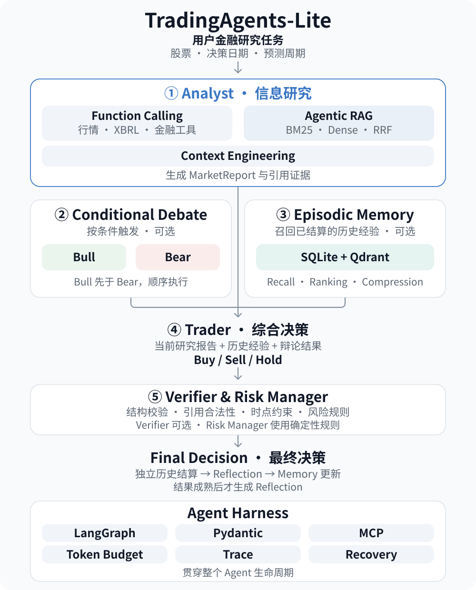
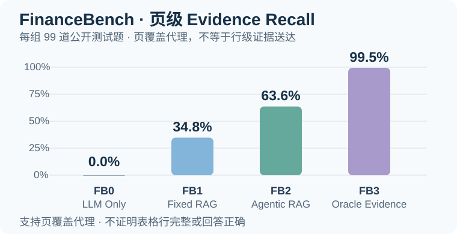
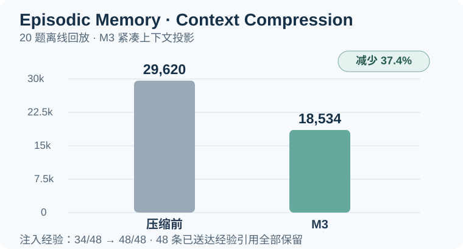
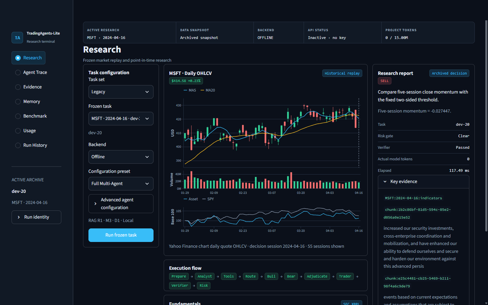
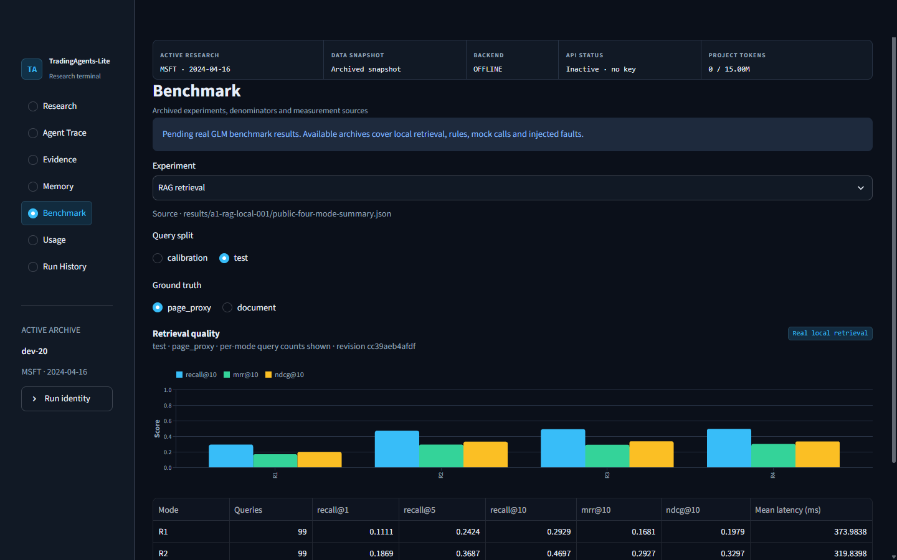

# TradingAgents-Lite

**面向历史金融研究的 Agent 系统：**把时点受限的行情与金融证据，经由检索、工具调用、结构化决策和独立结算，形成可追踪的研究轨迹。

项目用于离线历史研究，不连接券商、不提交订单，也不声称实现无污染回测或稳定投资收益。

[系统架构](#系统架构) · [实验结果](#benchmark-结果) · [源码导航](#源码导航) · [Quick Start](#quick-start) · [完整实验报告](docs/benchmark-results.md)

## 核心量化结果

- **FinanceBench Agentic RAG：**公开 99 题、四组共 396 个真实模型实例。动态检索组准确率为 **68.7%**，固定检索组为 **46.5%**，差 **+22.2 个百分点**；FB2 平均用量与延迟也更高。
- **有界恢复：**离线配对故障注入中，启用恢复后的任务完成数从 **5/60（8.3%）**升至 **45/60（75.0%）**。这是故障注入结果，不是生产 SLA。
- **Episodic Memory：**M3 将示例回放上下文从 **29,620** 压至 **18,534 bytes（−37.4%）**，48/48 条已选经验成功装入且保留引用。
- **Counterfactual Private Test：**本地评分汇总为 CF0 **20/20**、CF1 **18/20**；两组 Planning 均为 **6/6**，严格 Adaptive Planning 的 CF1 为 **0/6**。正式题目、Gold、随机种子和原始预测不公开；当前只有本机聚合结果核验，尚无脱敏正式报告。
- **检索重排实验：**独立 A1-V3 分支的 BGE Reranker 在公开测试集 Recall@5 为 **53.54%**，较 E0 的 39.90% 高 **13.64 个百分点**；热均值延迟约 **2.52×**，因此没有替换主线默认检索配置。

详细口径、Token / 延迟代价及实验局限见[Benchmark 结果汇总](docs/benchmark-results.md)。

## 系统架构

<picture>
  <source media="(prefers-color-scheme: dark)" srcset="docs/figures/system-architecture-dark.svg">
  <source media="(prefers-color-scheme: light)" srcset="docs/figures/system-architecture.svg">
  
</picture>

MarketReport 可直接送给 Trader。Debate、Memory、Verifier、MCP 为可选模块。布局展示逻辑模块关系，不代表并行执行。

图中的 **Context Engineering** 是概括名称。常规金融 Agent 的 **Context Delivery** 按工具输出限制送达证据，FinanceBench V2 的 **Query-aware Context Selection** 另外按查询选择证据片段并限制请求字节数。完整工作流与专题图解见[架构与技术图解](docs/technical-diagrams.md#详细系统工作流)。

### 核心模块

- **Analyst 与检索：**LLM 通过注册工具读取时点行情、XBRL 派生指标和金融证据；RAG Retriever 负责 BM25、BGE Dense 与 RRF 排序，Agent 决定是否发起下一轮检索。FinanceBench V2 的 Context Selection 做 query-aware 片段选择和请求字节预算；常规 RAG 工具保留 Top-K 与 excerpt 上限。
- **Trader、Debate 与风险门：**MarketReport 和证据交给 Trader；条件路由可跳过或依次调用 Bull、Bear，再由 Trader 综合。独立风险节点按确定性阈值处理高波动与无效提案。
- **Episodic Memory：**只读取已结算且满足决策时点、任务分区和实验组条件的历史经验；SQLite 保存权威记录，Qdrant 是可重建向量索引。
- **Agent Harness：**LangGraph State 串联节点；Pydantic 校验参数与报告；Tool Registry 统一本地/MCP 工具契约；TokenBudget 逐请求预留；Trace 保存状态、引用与错误。Verifier 校验结构、引用身份/范围/可见时间和规则风险，**不做完整的自然语言事实蕴含核验**。

## Benchmark 结果

### FinanceBench：真实 LLM / 公开基准复评

| 组别 | 正确答案 | 任务完成 | 答案准确率 | 页级证据召回 | 平均记账 Tokens | 平均延迟 |
|---|---:|---:|---:|---:|---:|---:|
| FB0 · LLM Only | 12/99 | 99/99 | 12.1% | 0.0% | 239.8 | 2.55 s |
| FB1 · Fixed RAG | 46/99 | 99/99 | 46.5% | 34.8% | 1,069.5 | 4.75 s |
| FB2 · Agentic RAG | 68/99 | 92/99 | 68.7% | 63.6% | 2,642.0 | 15.63 s |
| FB3 · Oracle Evidence | 70/99 | 98/99 | 70.7% | 99.5% | 783.1 | 2.48 s |

FB2 比 FB1 多答对 22/99 题（**+22.2 个百分点**），但平均记账 Tokens 约为 2.47×、平均延迟约为 3.29×，且有 7 个执行失败保留在分母。总计 585 次 HTTP 请求，正式运行记账 468,704 Tokens。FB3 只提供本题获准的官方支持证据，不提供 Gold 答案。页级 Recall 是证据页覆盖代理，不保证财务行完整或结论正确。

FinanceBench 是公开数据集，存在模型预训练污染风险。228 个不适合自动裁定的答案由 Codex 按冻结规则逐条裁定；这不是外部领域专家复核，复杂文本答案仍建议人工抽查。完整方法与逐组指标见[正式评测报告](docs/financebench-v2-formal-report.md)。

### Harness 故障注入：离线

60 个配对故障场景，每种配置运行同一套离线注入；F0 完成 5/60，F1 完成 45/60。结果说明有界恢复和安全降级对这套注入用例的作用，不代表线上 SLA。见 [A3 离线报告](results/a3-offline-001/REPORT.md)。

### Episodic Memory：离线回放

M3 的 Recall@3 为 **0.565**，低于 M2 的 **0.631**；因此本结果只支持“上下文更紧凑、所选经验送达率更高”，不支持“检索准确率提升”。详见 [Memory 报告](results/a2-memory-local-001/REPORT.md)。

### Conditional Debate：离线任务

在 20 个离线任务上，D1 固定辩论产生 40 次角色调用，D2 条件辩论触发 9/20 题、产生 18 次角色调用（−55%）。角色调用次数不等于真实 Token 节省比例。见 [A3 离线报告](results/a3-offline-001/REPORT.md)。

### 补充评测：私有任务与检索优化

私有 Counterfactual Test 共 20 道合成任务、40 个真实模型实例，CF0 为 20/20、CF1 为 18/20，Planning 均为 6/6，CF1 严格 Adaptive Planning 为 0/6。当前只核验了本机评分聚合，未找到脱敏正式报告；隐私边界及完整指标见[结果汇总](docs/benchmark-results.md)。

A1-V2 在公开 Test 的 Recall@5 从 39.90% 到 41.92%，配对区间包含零；独立 A1-V3 分支的 BGE Reranker 达 53.54%，但热均值延迟约为 E0 的 2.52×，未替换主线默认。BM25、Dense、Hybrid 与 Reranker 的完整对照和分支报告链接见[检索结果](docs/benchmark-results.md)。

## Streamlit 界面

项目提供 Research、Agent Trace、Evidence、Memory、Benchmark、Usage 与历史运行浏览页面。以下为已归档界面截图：

[界面设计系统](docs/ui-design-system.md) · [Streamlit 教学](docs/learning/ui.md)

## 源码导航

| 面试关注点 | 实现入口 |
|---|---|
| LangGraph 工作流与节点路由 | [workflow.py](tradingagents_lite/workflow.py) |
| GLM/OpenAI-compatible Provider、请求参数与重试/预算边界 | [provider.py](tradingagents_lite/provider.py) |
| Function Calling 工具契约 | [tool_registry.py](tradingagents_lite/tool_registry.py) |
| BM25、Dense、RRF 与时点过滤 | [rag.py](tradingagents_lite/rag.py) · [vectors.py](tradingagents_lite/vectors.py) |
| FinanceBench 动态检索、Context Selection 与轨迹 | [financebench.py](tradingagents_lite/financebench.py) |
| Episodic Memory、排序和压缩 | [memory.py](tradingagents_lite/memory.py) |
| Analyst / Trader / Bull-Bear 与运行恢复 | [agents.py](tradingagents_lite/agents.py) |
| 引用、范围、时点及风险规则校验 | [verifier.py](tradingagents_lite/verifier.py) |
| SQLite TokenBudget 账本 | [token_budget.py](tradingagents_lite/token_budget.py) |
| 私有 Counterfactual Runner 与隔离 | [counterfactual_runner.py](tradingagents_lite/counterfactual_runner.py) |
| Counterfactual 独立评分 | [counterfactual_score.py](tradingagents_lite/counterfactual_score.py) |
| 任务执行、历史结算与聚合 | [runner.py](tradingagents_lite/runner.py) |

## Quick Start

Python 3.12 与 uv。安装锁定依赖并运行离线回归：

~~~sh
git clone https://github.com/yicheng123123/TradingAgents-Lite.git
cd TradingAgents-Lite
uv sync --locked --group ui
uv run --locked pytest -q
~~~

在准备好项目本地数据快照的环境中启动 Streamlit；启动命令不发起 GLM 请求：

~~~sh
uv run --locked --group ui streamlit run streamlit_app.py \
  --server.address 127.0.0.1 \
  --server.headless true \
  --browser.gatherUsageStats false
~~~

真实模型运行需要用户自行配置密钥、恢复已有 TokenBudget 账本并通过实验协议的预算预检。不要把 API Key 或本地实验私有数据写入仓库。

## 实验局限与后续计划

- **历史行情不是 point-in-time 数据证明：**供应商可能事后修订行情或复权；SEC 文件披露时点与首次可见时点不同；历史新闻版本不完整。
- **模型知识不可回溯锁定：**公开 FinanceBench 可能受到预训练污染。私有合成题可验证隔离流程，但不能证明闭源模型绝无污染。
- **Verifier 能力有边界：**它检查结构、引用身份/范围、时点和确定性风险条件，不验证所有自然语言陈述都由证据蕴含。
- **真实历史股票任务状态：**V3 已冻结 80 道 Development 与 100 道 Holdout；当前公开归档包含 4/4 实例的 GLM-5.3-Flash Smoke，不等于完成 80 题 Development。Holdout 仍封存，未评估交易表现。
- **Benchmark 状态：**FinanceBench 99 题是已重复使用的公开测试集；Counterfactual Private Test 仅本机评分聚合可核验，暂无脱敏正式报告。两者不能替代独立、时间隔离的真实金融 Holdout。
- 后续路线与冻结边界见[项目路线图](docs/roadmap.md)及[最终 Benchmark 协议](docs/final-benchmark-protocol.md)。旧首页的开发记录、运行命令与冻结说明已完整保存在[历史 README 快照](docs/project-history.md)。

## 上游来源与许可证

本项目以 TauricResearch/TradingAgents 的设计为参考；经审计的上游版本为 9fa1196fffbcfd9de5146d2dd2869df84ab99838。本项目独立实现 Python、Prompt、测试与评测流程，没有复制上游 Python 代码或 Prompt。仓库保留上游 Apache-2.0 许可证文本及来源声明。详情：[上游审计](docs/upstream-audit.md) · [LICENSE](LICENSE) · [NOTICE](NOTICE) · [上游仓库](https://github.com/TauricResearch/TradingAgents/tree/9fa1196fffbcfd9de5146d2dd2869df84ab99838)。
