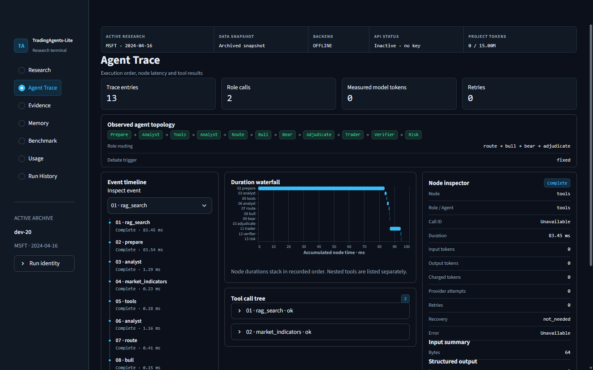

# TradingAgents-Lite

一个可审计、可复现的轻量金融研究 Agent 项目。当前版本把历史任务、行情视图、时点证据、有限工具调用、结构化决策和独立结算连接起来。项目用于离线历史研究，不执行交易。

上游设计参考 TauricResearch/TradingAgents；本项目独立实现。来源、许可证和声明见 [docs/upstream-audit.md](docs/upstream-audit.md)、[LICENSE](LICENSE) 和 [NOTICE](NOTICE)。

## 阶段状态

- **A0**：4 题确定性五日动量 smoke，结果保存在 results/smoke-a0-001。该归档保持不变。
- **A0.5**：20 个 Development 时点的历史证据层。SEC 财报为 20/20 历史代理可用；Apple Newsroom 标题为 10/20；Microsoft 新闻显式缺失；严格版本时点认证为 0/20。逐题证据见 [A0.5 覆盖报告](results/evidence-dev-a05-001/REPORT.md)。
- **B0**：20 题确定性 Development 基线，独立保存于 results/b0-development-001。
- **B1**：真实 GLM 的 B1-M 行情组与 B1-E 行情加 A0.5 证据组。原 GLM-5.3 Smoke 归档保留且结果为 1/4 实例、0 个有效配对；独立 Flash V2 协议见 [B1 Flash V2](docs/b1-v2-protocol.md)。没有成功的真实调用时不会生成模型成绩。
- **A1**：本地文档解析、Qdrant、BM25 / Dense / RRF / Cross Encoder，支持固定查询与 Analyst 自主查询。[A1 RAG](docs/learning/a1-rag.md)
- **A2**：按结算事件推进的 SQLite / Qdrant 长期经验，提供 M0–M3 配置。[A2 Memory](docs/learning/a2-memory.md)
- **A3**：可选 Bull/Bear、MCP STDIO、确定性 Verifier 和有界恢复。[离线评测](results/a3-offline-001/REPORT.md) · [A3 教学](docs/learning/a3-agents.md)

B1 V1 冻结协议默认 GLM-5.3；新协议单独使用准确模型 ID `glm-5.3-flash`，不回退到付费模型。两版结果不会混合。参考[Flash 官方模型文档](https://docs.bigmodel.cn/cn/guide/models/vlm/glm-5.3-flash)、[Thinking 文档](https://docs.bigmodel.cn/cn/guide/capabilities/thinking)与[Function Calling 文档](https://docs.bigmodel.cn/cn/guide/capabilities/function-calling)。

Flash V2 使用原始冻结的 20 道 Development 任务、A0.5 数据和 B0 结算。Smoke 固定 `dev-01`、`dev-02`，按任务配对运行 B1-M/B1-E；只有成功的 Flash Smoke 才能续跑其余 18 题。运行命令、预算策略、数据 hash 和模型身份检查见 [B1 Flash V2 协议](docs/b1-v2-protocol.md)。

## B1 V1 冻结协议（归档）

B1 使用固定的 Development 20 题、A0.5 行情快照和证据快照。两个模型组共用核心提示、模型、temperature=0、每次调用最多 512 tokens、messages + tools 最多 5,000 bytes、最多 2 轮分析师工具调用、每轮至多 2 个工具调用、25 秒超时和同一风险门与结算代码。B1 不自动重试，OpenAI SDK 自动重试也关闭。

- B1-M：行情工具。
- B1-E：相同行情工具，另开放按决策时点过滤的财务证据工具。
- 首轮 smoke 固定为 dev-01 / AAPL 与 dev-02 / MSFT，两题同一决策日期。
- 模型生成不设置供应商 seed；seed 42 仅用于统计重采样。
- 请求提示与工具定义的 SHA-256、模型调用次数、返回模型名、token 用量、延迟和失败状态都写入 run manifest 与逐题 trajectory JSONL。
- 结算为决策后下一共同交易日开盘到第 N 个共同交易日收盘的价格收益，Alpha 减 SPY 同期价格收益；不含费用、股息、融券与组合执行。
- 项目 GLM 总预算为 15,000,000 tokens；B1 阶段预算为 1,000,000，smoke 单次实验硬上限为 120,000。按 5,000-byte prompt、512 output tokens、额外 512 reasoning reserve 及 128 协议 allowance 计算，smoke 保守上限为 98,432 tokens，Full Development 为 984,320 tokens。调用前逐请求预留；失败或 usage 缺失时按完整预留量计费。
- 对应智谱标准价的静态上限为 smoke ¥1.115136、Full Development ¥11.151360。它们是边界估算，不是已发生费用；详细阶段预算、局限和实现见[全局 Token 预算教学](docs/learning/token-budget.md)。

成本预估使用截至 2026-11-24 的智谱标准单价：GLM-5.3 输入 ¥8 / 百万 tokens，输出 ¥28 / 百万 tokens。账户折扣、缓存计费和平台最终账单可能不同。价格来源：[智谱 API 定价](https://docs.bigmodel.cn/cn/guide/start/pricing)。

## 安装与测试

~~~sh
cd ~/projects/tradingagents-lite
uv sync --locked
uv run --locked pytest -q
~~~

核心依赖为 Python 3.12、LangGraph、Pydantic 与 OpenAI-compatible Python SDK。项目不需要 GPU，也不自动安装大型模型依赖。

## 运行 B0

首次为冻结的 Development 20 题生成离线规则基线：

~~~sh
uv run --locked talite b0   --tasks tasks/development.jsonl   --data data/yahoo-2024-v1   --output results/b0-development-001   --seed 42
~~~

输出包括 run.json、summary.csv、REPORT.md、tasks.jsonl、trajectory.jsonl 和本地 SQLite 账本。SQLite 文件不纳入 Git。

## 配置 GLM 并运行两题 B1 smoke

模型名与 Base URL 有默认值。运行前还必须指向已有的项目 SQLite 账本；不要创建空账本替代它。只在 WSL 当前 shell 安全配置 Key，不要将 Key 写入仓库或聊天：

~~~sh
# 先将此路径改为已存在且包含历史用量的项目账本。
export TALITE_TOKEN_BUDGET_DB=/absolute/path/to/existing/token-budget.sqlite
read -rsp "TALITE_API_KEY: " TALITE_API_KEY
printf '\n'
export TALITE_API_KEY
uv run --locked talite b1 --scope smoke --output results/b1-smoke-004
unset TALITE_API_KEY
~~~

若成功，输出含 B1-M、B1-E 两组独立 run manifest、逐题 JSONL trajectory、汇总 CSV、逐题配对 Alpha 和报告。smoke 输出目录必须是新路径，程序不会覆盖已有结果。API Key 缺失时会记录明确的 blocked 状态，不会发出请求；账本缺失时会失败关闭，不会创建一个空账本。

两题 smoke 用于确认 GLM Function Calling、Pydantic 结构校验、证据引用、费用统计和结算链路。它不是性能结论。模型失败、无效引用与无法解析输出均留在失败分母，不会伪装成正常 Hold。

## 复用 Smoke 完成 20 题

Smoke 成功后，可复用 dev-01 / dev-02 的四条成功轨迹，仅执行另外 18 题。续跑前会核验原轨迹和 SQLite 账本记录；配置、模型身份或数据 hash 不一致时拒绝续跑。随后从两个只读来源生成完整 20 题归档，不会重算 Smoke Token，也不会改写来源归档。

~~~sh
uv run --locked talite b1 --scope development \
  --resume-from results/b1-smoke-004 \
  --budget-cap-cny 10.036224 \
  --output results/b1-development-remainder-001

uv run --locked talite b1-merge \
  --smoke results/b1-smoke-004 \
  --continuation results/b1-development-remainder-001 \
  --output results/b1-development-001
~~~

剩余 18 题的保守请求上界是 885,888 tokens / ¥10.036224；与 Smoke 上界合计 984,320 tokens / ¥11.151360。Smoke 的独立硬上限仍是 120,000 tokens。实际执行还要求 `TALITE_API_KEY` 和已存在的项目账本；账本缺失时 B1 会停止，不会新建一个空账本并把历史累计当成零。密钥应在 Shell 中安全设置，不写进仓库。若价格、模型预算或重试协议变化，应冻结新协议并使用新目录。当前开发集不是 Holdout；本项目尚未访问最终 Holdout。

续跑细节见[单独的 B1 Smoke 复用协议](docs/b1-resume-protocol.md)。

## 指标和边界

报告包含 Task Completion Rate、Structured Output Valid Rate、Tool Success / Recovery、Non-Hold Coverage、非 Hold 方向命中率及分母、Mean Alpha、日期聚类区间、B1-E−B1-M 配对 Alpha、有效/无效证据引用、输入/输出 tokens、模型调用、延迟与标准价格估算。按 AAPL、MSFT 和全体分别统计。样本很小的 smoke 不提供虚假的显著性结论。

行情是历史下载的 Yahoo Finance 回溯快照，存在供应商事后修订和复权限制。A0.5 证据多数为历史代理，不是经首次可见时间认证的 point-in-time 数据。模型预训练知识也无法按历史日期截断。该实验只能称为冻结数据上的历史研究基线，不能称为严格历史回测、可交易策略或真实收益。

## A3 离线运行

~~~sh
uv run --locked talite a3 --debate D2 --transport mcp --verifier --repair --output data/a3-dev-new
uv run --locked talite a3-benchmark --output data/a3-benchmark-new
~~~

真实 GLM 实验仍待完整验收。

## 本地研究界面

~~~sh
uv run --locked --group ui streamlit run streamlit_app.py --server.address 127.0.0.1 --server.headless true --browser.gatherUsageStats false
~~~

打开输出的本机地址。Frontend V2 默认使用 Offline。Research 提供冻结行情、Agent 配置和决策报告。Agent Trace、Evidence 与 Memory 共享同一归档。Benchmark、Usage 和 Run History 分别提供实验、账本和历史运行的浏览入口。

[设计系统与七页截图](docs/ui-design-system.md) · [界面教学](docs/learning/ui.md)

Usage 内 Token Dashboard 的项目硬上限显示为 **15.00M（15,000,000 Tokens）**。若启动应用的 WSL 进程已设置 `TALITE_API_KEY`，可在 **BigModel Account** 点击 **Refresh BigModel account** 查询人民币余额和明确适用于 GLM-5.3 的资源包。成功结果在当前页面会话缓存 60 秒。控制台接口可能因账户权限或返回结构变化而不可用。账户查询独立于项目 SQLite 账本和模型执行。[账户查询说明](docs/learning/ui.md#bigmodel-account)

### Data Expansion V2

V2 冻结了 20 只股票及 380 道五交易日任务。Offline Extended 200 题已完成确定性基线，Development V2 80 题可在 Research 中选择，Final Holdout 100 题保持封存。实时 SEC 批量采集依赖本机配置的 `SEC_USER_AGENT`。本轮使用官方缓存和发行人资料，真实 GLM 消耗为 0。[数据与复现命令](docs/data-expansion-v2.md) · [金融数据教学](docs/learning/financial-data.md)

## 后续模块

A1 与 A2 由通用实验入口单独开启。A3 可通过 `talite a3` 单独开启。B2 消融和 B3 Final Holdout 见[路线图](docs/roadmap.md)。B1 保持原有配对协议。

完整调用链、状态传递与练习见 [docs/learning/b1.md](docs/learning/b1.md)；协议和字段定义见 [docs/b1-protocol.md](docs/b1-protocol.md)。
