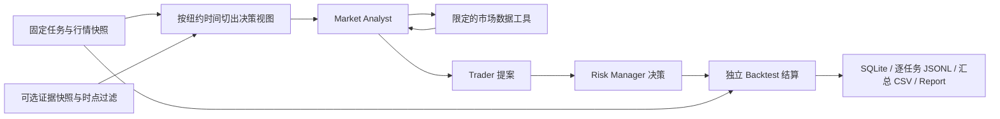

# A0 与 A0.5 架构

- 每个任务创建新的 graph state。Market Analyst 最多两轮工具调用（可配置），每轮最多两工具，错误以结构化观察返回。工具固定在当前股票和截止日期。禁用 ReAct 时预取同一套技术指标。
- Trader 只接收 Market Analyst 有效报告引用过的证据。方向决策必须有有效引用，Risk Manager 独立检查日收益波动率阈值。异常转换成不可计分的失败记录。
- 评测器持有完整行情，所有未来价格只用于决策完成后的结算。SQLite 是逐任务事务账本，JSONL 为逐任务导出。如果进程在 SQLite 写入后中断，账本可能比 JSONL 多一行。当期使用新目录独立执行。
- 股票与 SPY 必须共享完成的结算窗口。决策截止为纽约本地 **16:15**，最早进入价格为下一共同交易日开盘，到第 N 个共同交易日收盘。Sell 是负向研究信号。Alpha 定义为方向乘以股票和 SPY 区间价格收益之差。按任务独立结算，排除费用、融券和股息现金流。
- 止算数据和工具输入可测试。快照供应商可能事后修订或复权，且固定股票存在样本选择、幸存者偏差。LLM 自带知识无法像数据工具一样按日期截断。第一期是受时点约束的历史快照研究，无法认证它为严格 point-in-time 市场数据。

A0.5 在绑定 MarketView 时一并绑定 EvidenceView。Agent 只能访问截止时点之前合规的版本。证据按原稳定 ID 进入观察和引用，对结果结算没有数据回流。后续向量数据库、RAG、MCP 和已结算经验应共用同一时间过滤接口。[证据协议](point-in-time.md) · [项目路线图](roadmap.md)
