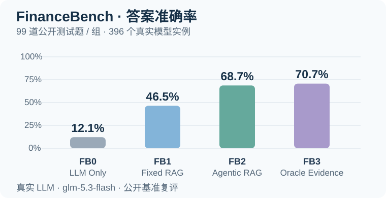
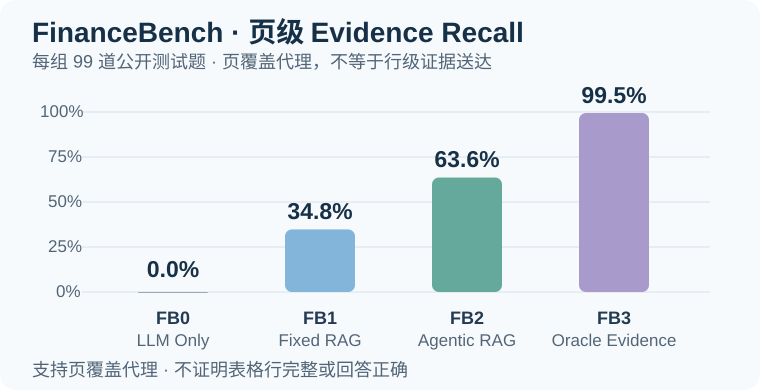
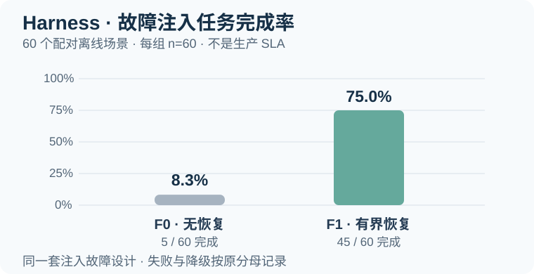
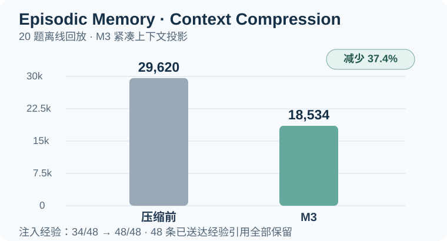
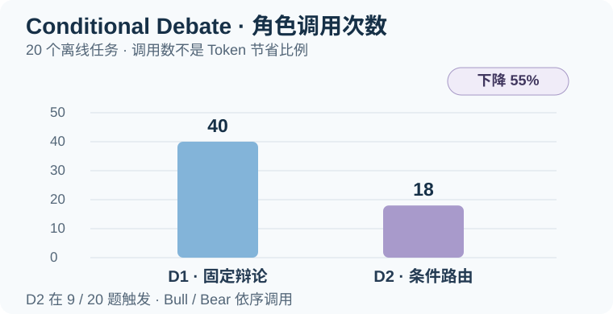

# Benchmark 结果与边界

本页汇总面向展示的已归档结果。指标保持各自原协议，不跨 Benchmark 合并。

## FinanceBench V2：99 道公开测试题

使用 glm-5.3-flash，FB0–FB3 共 396 个真实模型实例。准确率分母固定为每组 99；工具失败保留在分母中。FB2 有 7 个执行失败，因此完成率与正确率分开报告。

| 组别 | Accuracy | 完成 | Evidence Recall@Page | 平均 Tokens / 实例 | 平均延迟 | 工具调用 |
|---|---:|---:|---:|---:|---:|---:|
| FB0 · LLM Only | 12/99 · 12.1% | 99/99 | 0.0% | 239.8 | 2.55 s | 0 |
| FB1 · Fixed RAG | 46/99 · 46.5% | 99/99 | 34.8% | 1,069.5 | 4.75 s | 2.00 |
| FB2 · Agentic RAG | 68/99 · 68.7% | 92/99 | 63.6% | 2,642.0 | 15.63 s | 1.47 |
| FB3 · Oracle Evidence | 70/99 · 70.7% | 98/99 | 99.5% | 783.1 | 2.48 s | 0 |

FB2−FB1 为 **+22/99 = +22.2 个百分点**；公司聚类 Bootstrap 95% 描述区间为 +14.3 至 +32.0 个百分点。FB2 比 FB1 多记账 155,678 Tokens，平均延迟约 3.29 倍。全实验 585 次 HTTP 请求，记账 468,704 Tokens；这属于本轮账本保守计量，不等同供应商最终现金账单。

公开基准的题目可能出现在模型预训练数据中。228 个自动评分待复核结果由 Codex 按冻结问题、Gold 与评分规则做逐条裁定；这不是外部专家审阅，建议对自由文本及复杂财务口径进行人工抽查。页级 Recall 不等于完整证据行进入上下文。更多配置、配对错误和复现步骤见[正式报告](financebench-v2-formal-report.md)。

## Harness 故障注入：60 个配对场景

| 离线设置 | 完成任务 | 工具调用成功 | 恢复 | 降级 |
|---|---:|---:|---:|---:|
| F0 · 无恢复 | 5/60 · 8.3% | 35/60 | 0/60 | 0/60 |
| F1 · 有界恢复 | 45/60 · 75.0% | 65/90 | 35/60 | 5/60 |

F0/F1 使用相同的 60 个故障设计，分别执行，属于离线注入评测；完成率不是生产环境 SLA。结构、引用和 Verifier 结果保留其各自分母，见 [A3 离线报告](../results/a3-offline-001/REPORT.md)。

## Episodic Memory：20 题离线回放

| Memory 配置 | Recall@3 | 注入上下文的经验 | 上下文大小 |
|---|---:|---:|---:|
| M2 · 语义排序 | 0.631 | 34/48 | 20,982 bytes |
| M3 · 综合排序与压缩 | 0.565 | 48/48 | 18,534 bytes |

初始上下文为 29,620 bytes；M3 压缩后减少 37.4%，并保留全部 48 条已送达经验的历史引用。M3 的 Recall@3 低于 M2，故结论限于上下文使用率和体积，不声称召回质量提高。详见 [A2 报告](../results/a2-memory-local-001/REPORT.md)。

## Conditional Debate：20 个离线任务

D1 固定辩论调用 Bull/Bear 角色共 40 次。D2 依条件路由，在 9/20 题触发，角色调用共 18 次，减少 55%。这里统计的是角色调用次数，不能换算为相同比例的真实 Token 节省。D0/D1/D2 的完整数据见 [A3 离线报告](../results/a3-offline-001/REPORT.md)。

## Counterfactual Private Test：本机聚合核验

当前没有脱敏正式报告。为遵守私有数据边界，只核对本机独立评分文件 summary 区，不读取或公开任务正文、Gold、种子、逐题预测和案例 ID。

| 组别 | 实例 | Answer Accuracy | Counterfactual Pair Accuracy | Planning | Strict Adaptive Planning | Abstention |
|---|---:|---:|---:|---:|---:|---:|
| CF0 · Fixed RAG | 20 | 20/20 | 10/10 母案例 | 6/6 | 不适用 | 8/8 |
| CF1 · Agentic RAG | 20 | 18/20 | 8/10 母案例 | 6/6 | 0/6 | 8/8 |

共 20 道合成任务、40 个真实模型实例；两组 Future Evidence Acceptance 均为 0。以上仅是当前工作区本机评分聚合字段的核验结果，尚未作为脱敏报告提交或发布。Private Test 数据及原始预测不进入 Git。

## A1 Retrieval：候选池、Hybrid 融合与 Cross-Encoder

A1-V2 及 A1-V3 在各自隔离实验分支运行，未改主线默认配置。所有百分比是页级检索指标，Calibration 与 Public Test 不混在同一分母中。

### Calibration：BM25 / Dense 候选覆盖

| Candidate K | BM25 页召回 | BGE Dense 页召回 | 候选并集页召回 |
|---:|---:|---:|---:|
| 24 | 29.6% | 60.2% | 67.3% |
| 50 | 45.6% | 76.5% | 81.3% |
| 100 | 57.8% | 88.8% | 89.5% |

候选并集召回是排序前的上限诊断，不是 Top-5 结果。A1-V2 在 99 道 Public Test 上将 R3 Recall@5 从 39.90% 提到 41.92%，差值 +2.02 个百分点；配对区间 −1.34 至 +6.00，包含零。

### Reranker 消融与公开 Test 复评

| 组别 | Calibration Recall@5 | Public Test Recall@5 | 备注 |
|---|---:|---:|---|
| E0 · 原始 R3 Hybrid | 27.55% | 39.90% | BM25 + BGE Dense + RRF |
| S1 · A1-V2 Weighted RRF | 33.67% | 41.92% | K=50，Dense/BM25=0.80/0.20，单页限额 |
| S2 · MiniLM Cross-Encoder | 28.57% | 未运行 | 完整 Top-50+Top-50 候选并集 |
| S3 · BGE Reranker v2-m3 | 53.06% | 53.54% | 与 S2 相同候选池；热均值约 2.52× E0 |
| S4 · BGE Reranker，K=100 | 48.98% | 未运行 | 更大候选池，五项返回上限不变 |

A1-V3 选择 S3 为离线质量候选，但延迟超过预设部署门槛；S1 是延迟可接受候选，E0 仍是主线默认。A1-V2 Test 区间包含零；A1-V3 结果来自重复使用的公开基准，不是新的独立 Holdout。A1-V2 报告：[分支报告](https://github.com/yicheng123123/TradingAgents-Lite/blob/experiment/a1-retrieval-v2/results/a1-retrieval-v2/REPORT.md)。A1-V3 报告：[分支报告](https://github.com/yicheng123123/TradingAgents-Lite/blob/experiment/a1-retrieval-v3/results/a1-retrieval-v3/REPORT.md)。