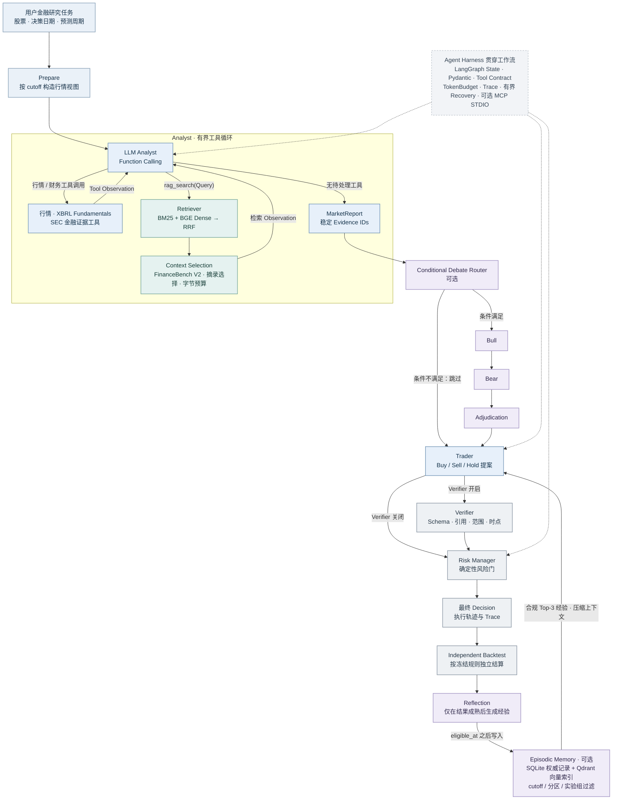
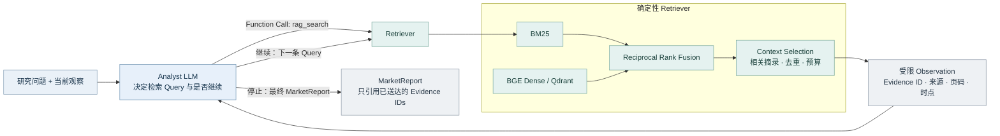
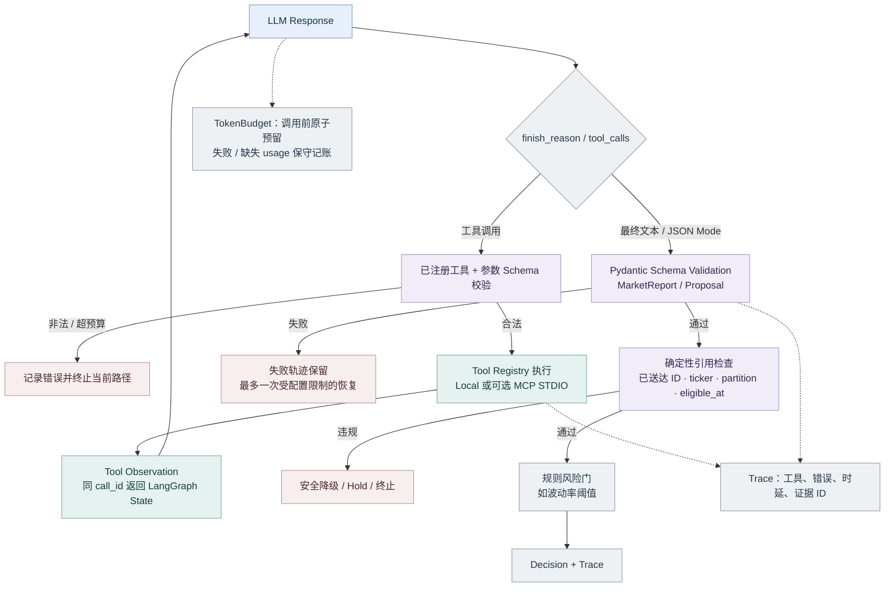

# 架构与技术图解

本文按当前主线源码描述逻辑数据流。A1-V3 Cross-Encoder 是独立离线实验分支，不代表主线默认检索器。原有 B1 工作流、时点与结算说明保留在[架构历史说明](architecture.md)。

## 详细系统工作流

MarketReport 可直接进入 Trader。条件式辩论开启时，Bull、Bear 与 Adjudication 按顺序执行。Memory 部分展示 Trader 读取已结算经验的关系。Reflection 在独立结算的结果成熟后生成，更新后的经验受后续任务的时点约束。图中的 Context Selection 标明 FinanceBench V2 的独立实现。

## Agentic RAG

Retriever 是确定性的混合检索组件；Agentic Retrieval Loop 是上层 Analyst 根据观察决定是否继续检索的有界控制流。固定检索组不拥有动态 Query 决策权。

Retriever 根据 ticker、分区、截止时点和 PIT 等范围先过滤候选，再计算 BM25 / Dense 排名及 RRF。LLM 只在 Agentic 配置中决定查询内容和是否继续；检索结果作为 Tool Observation 返回。FinanceBench V2 的 Context Selection 另外按 query-aware 规则选择完整片段，并对最终序列化消息施加预算。两层不要混为一个检索算法。

实现位置：[workflow.py](../tradingagents_lite/workflow.py)、[rag.py](../tradingagents_lite/rag.py)、[financebench.py](../tradingagents_lite/financebench.py)、[vectors.py](../tradingagents_lite/vectors.py)。

## Episodic Memory

Memory 仅在 episode 已结算且 eligible_at 不晚于任务 cutoff 后可见。SQLite 是权威记录；Qdrant 是可恢复的向量索引。默认最多取 Top-3，随后对记录做紧凑投影并受上下文字节上限控制。

```mermaid
flowchart LR
    DECISION["历史 Decision<br/>输入证据与执行轨迹"] --> SETTLE["延迟结算<br/>outcome_ts"]
    SETTLE --> REFLECT["Reflection<br/>规则逻辑或受预算约束的模型"]
    REFLECT --> STORE["SQLite + Qdrant<br/>版本化、幂等写入"]
    STORE --> FILTER["时点与范围过滤<br/>ticker · cutoff · partition · arm"]
    FILTER --> RANK["语义相似度 + 时间衰减<br/>+ Evidence Quality"]
    RANK --> TOP["Top-3"]
    TOP --> COMPRESS["Context Compression<br/>保留来源和历史 Evidence IDs"]
    COMPRESS --> TRADER["后续任务的 Trader<br/>历史经验只作参考"]

    classDef base fill:#EAF1F8,stroke:#8CA4BA,color:#163047;
    classDef memory fill:#E5F2F0,stroke:#79A99D,color:#173E38;
    classDef filter fill:#F0ECF8,stroke:#A597C5,color:#30294B;
    classDef trader fill:#EEF1F4,stroke:#8D99A6,color:#273746;
    class DECISION,SETTLE,REFLECT base;
    class STORE,RANK,TOP,COMPRESS memory;
    class FILTER filter;
    class TRADER trader;
```

M3 的实际排序公式：

~~~text
Score = 0.65 × Semantic + 0.25 × exp(-age_days / 30) + 0.10 × Evidence Quality
~~~

这是人工配置的加权规则，不是训练得到的参数。余弦相似度先映射到 [0, 1]；时间项以 30 天衰减；证据质量缺失时，以已观察 Evidence ID 数量做有界代理。M3 的上下文压缩不代表 Recall 提升：本地回放中 M3 Recall@3 为 0.565，低于 M2 的 0.631。

实现位置：[memory.py](../tradingagents_lite/memory.py)、[runner.py](../tradingagents_lite/runner.py)。

## Agent Harness

同一 Harness 管理状态、工具消息配对、请求预算和可追踪执行。Tool Calling 路径与最终结构化生成路径不同：参数先按工具 Schema 校验并执行；最终 MarketReport / Proposal 再进行 Pydantic 校验。启用时 Verifier 另外校验引用和范围；它不证明自由文本事实的语义蕴含关系。

**Verifier 当前实际边界：**结构合法、引用 ID 是否在已送达上下文、ticker/数据分区/版本/时点，以及确定性波动率规则。代码将 citation_entailment 明确标记为 not_assessed，因此不把它描述为完整事实核验。

实现位置：[workflow.py](../tradingagents_lite/workflow.py)、[provider.py](../tradingagents_lite/provider.py)、[tool_registry.py](../tradingagents_lite/tool_registry.py)、[verifier.py](../tradingagents_lite/verifier.py)、[token_budget.py](../tradingagents_lite/token_budget.py)、[agents.py](../tradingagents_lite/agents.py)。
