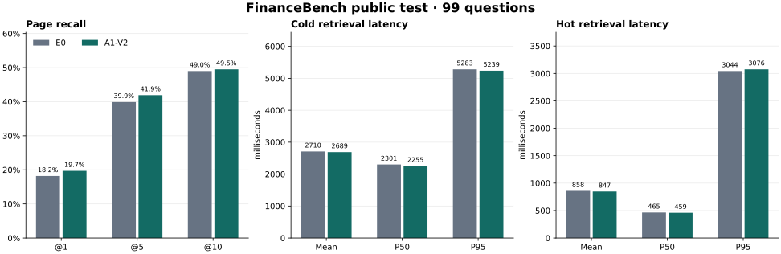

# A1-V2 FinanceBench 检索复评

## 实验边界

实验从 `main` 的 `243c3d24c8d622e0bddc8f09ebf0d5bf26430402` 在独立 worktree 开始。新模块复用现有同公司、分区、截止时点和版本过滤。Qdrant 仅打开独立副本，原索引和模型权重用文件指纹校验。未发生真实 GLM 请求或 Token 消耗。

来源是 FinanceBench 公共修订 `cc39aeb4afdf33909ee1412188bf89035950c2eb`，包含 150 道公开题。历史公司分区为 51 道 Calibration、99 道 Test。配置选择固定使用旧 pypdf 索引可评测的共同 49 道 Calibration；两道历史未对齐题保持排除。正式复评沿用全部 99 道题、原有页标签与评分函数。该 Test 已用于历史实验，本次属于公开基准复评。[FinanceBench 公共数据](https://github.com/patronus-ai/financebench)

原 83 份入库 PDF 的 SHA256 均与历史归档一致，索引含 36,622 个 Chunk。外部数据、84 份 PDF、索引内容、锁文件和源码的指纹统一记录于 `freeze.json`。切分复用旧 pypdf 索引的 220 词与 32 词重叠。Embedding 保持 Xenova BGE-small-en-v1.5 的固定 ONNX 修订和 CPU 推理，查询前缀及 L2 归一化复用现有实现。

## Calibration 根因

- 合法索引覆盖 63/63 个题目与 Gold 页对应项。Top-24 两路并集未召回所有 Gold 页的有 18/49 题。
- 在 22/49 题中，Top-24 候选并集中至少一个 Gold 页未进入 E0 的 Top-5，4 题同时存在候选遗漏。E0 的 Top-5 共出现 22 个重复页 Chunk，分布在 15 题。
- 63 个题目与 Gold 页对应项中，55 个可从官方证据摘录与本地 PDF 解析文本对齐数值行。识别出的 785 个数值行对应项均完整存在于至少一个旧 Chunk，邻近四行范围内可检测到的年份 162/162、文字单位 107/107 与财务行在某个 Chunk 内共现。
- 行诊断采用去标点后精确子串匹配。它能定位可观察的完整数值行，不能证明所有跨行表头、列顺序、正负号或单位关系都正确。剩余 8 个页对应项缺少可对齐的数值行，不能区分无适用数值行和解析损失。预设的切分重建阈值为至少 10 个可识别页对应项，其中至少 20% 的可识别数值行未完整出现在任何旧 Chunk。本次未达到触发条件。

| Candidate-K | BM25 页召回 | Dense 页召回 | 候选并集页召回 |
| ---: | ---: | ---: | ---: |
| 24 | 29.6% | 60.2% | 67.3% |
| 50 | 45.6% | 76.5% | 81.3% |
| 100 | 57.8% | 88.8% | 89.5% |

## Calibration 消融与冻结选择

| 单因素消融（其余参数同 E0） | Calibration 页级 Recall@5 | Top-5 平均唯一页数 |
| --- | ---: | ---: |
| E0，K=24，k=60，等权，无页面配额 | 27.55% | 4.55 |
| E1，最佳权重点 k=60，Dense 0.65 / BM25 0.35 | 29.59% | 4.55 |
| E2，K=50 | 26.53% | 4.49 |
| E2，K=100 | 28.57% | 4.47 |
| E3，每页最多 1 个 Chunk | 27.55% | 5.00 |
| E3，每页最多 2 个 Chunk | 27.55% | 4.61 |

单因素表的排名来自深度 100 的候选缓存。完整搜索为一次 81 点网格，按 Recall@5 排序并用辅助指标破平；要求 Recall@1、MRR@10、Recall@10 的绝对下降均不超过 0.03，热均值不超过同环境 E0 的两倍。仅对两个非基线候选做与 E0 同样的独立冷、热计时。

| 独立计时组 | Recall@1 | Recall@5 | Recall@10 | MRR@10 | nDCG@10 | 冷均值 (ms) | 热均值 (ms) |
| --- | ---: | ---: | ---: | ---: | ---: | ---: | ---: |
| E0 | 10.20% | 27.55% | 43.88% | 0.176 | 0.236 | 1,986 | 762 |
| K=50，k=60，Dense 0.80，每页 1 | 14.29% | 33.67% | 45.92% | 0.238 | 0.281 | 1,987 | 769 |
| K=100，k=30，Dense 0.80，每页 1 | 16.33% | 32.65% | 51.02% | 0.259 | 0.305 | 1,952 | 751 |

入选 K=50 的组合。可观察数值行的 Top-5 覆盖从 139/785 增至 204/785；该代理指标只看检索结果中是否有完整行。页级 Recall@5 始终只取五个 Chunk。保留旧切分和原 BGE-small 权重；Calibration 的数值行审计及组合收益未触发切分、Embedding、Reranker 扩展。最终配置与第一阶段最佳相同，正式复评只运行两组。

冻结文件 SHA256 为 99aa012750bd9c38c538f5f7e2c29f1b5228ec9d2e651d93749f7a9d44abcf2a。冷、热同时使用同一份物理索引。索引历史构建和四模式评测总耗时 2,593.8 秒，历史记录未单列构建耗时。本轮直接复制索引，新增索引构建数为 0。

### Candidate-K 的成本

以下均用 E0 的 RRF k=60、等权与无页面配额。在 Calibration 的 49 道题上单独计时，单位为 ms。

| K | 冷均值 | 热均值 | 热 BM25 均值 | 热 Dense 均值 | 热融合均值 |
| ---: | ---: | ---: | ---: | ---: | ---: |
| 24 | 1,986 | 762 | 72.7 | 332.1 | 0.135 |
| 50 | 2,002 | 773 | 72.7 | 351.2 | 0.240 |
| 100 | 2,025 | 796 | 65.0 | 371.9 | 0.270 |

较深的候选池提高候选页覆盖率，排序质量还取决于权重与页面配额。计时含资格范围扫描，因此总延迟高于三个阶段时间之和。所有 P50/P95 和完整 81 点网格均见汇总 JSON。

## 正式 Test 复评

两组均为 99/99 题，E0 逐题五项页级指标与历史归档 99/99 一致。最终配置与 Stage 1 相同，正式结果中只计一次。

| 组别 | 页 Recall@1 | 页 Recall@5 | 页 Recall@10 | MRR@10 | nDCG@10 | 文档 Recall@5 | 候选并集页召回 | Top-5 平均唯一页 |
| --- | ---: | ---: | ---: | ---: | ---: | ---: | ---: | ---: |
| E0 | 18.18% | 39.90% | 48.99% | 0.290 | 0.335 | 98.99% | 67.17% | 4.73 |
| A1-V2 | 19.70% | 41.92% | 49.49% | 0.309 | 0.350 | 97.98% | 79.29% | 5.00 |

两组索引的合法 Gold 页覆盖均为 100%，Top-5 均返回 5 个 Chunk。文档 Recall@1/5/10 在 E0 分别为 51.52% / 98.99% / 98.99%，A1-V2 为 52.53% / 97.98% / 97.98%。文档指标按原协议从前十个 Chunk 中对文档去重，再计算各深度的召回。

Recall@5 配对差为 **+2.02 个百分点**，8 题改善、3 题下降、88 题持平。以 21 家公司为聚类单元，固定随机种子做 10,000 次配对 Bootstrap，95% 区间为 **−1.34 至 +6.00 个百分点**。区间包含零，观测收益未达到 50% 的目标。Recall@1、Recall@10、MRR@10 和 nDCG@10 均小幅上升。

| 组别 | 冷延迟均值 / P50 / P95 (ms) | 热延迟均值 / P50 / P95 (ms) | 索引字节数 |
| --- | ---: | ---: | ---: |
| E0 | 2,710 / 2,301 / 5,283 | 858 / 465 / 3,044 | 228,156,404 |
| A1-V2 | 2,689 / 2,255 / 5,239 | 847 / 459 / 3,076 | 228,156,404 |

两组使用同一 WSL CPU 环境与索引文件。A1-V2 同环境平均冷、热延迟分别为 E0 的 0.99 倍和 0.99 倍。热测均值 847 ms 高于旧归档 364.5 ms 的两倍，本轮 E0 热均值也高于该数值。历史四模式连续查询已预热部分候选范围和查询向量，与本次独立分组计时的口径不同。Qdrant Local 首次范围扫描造成较高尾延迟。正式进程峰值 RSS 1,402,812 KiB，索引复制自旧版，新增索引构建耗时为零。

对离线实验保留 K=50、RRF k=60、Dense/BM25 0.80/0.20、每页最多 1 个 Chunk 的候选配置。若现阶段必须为主线选一个默认值，建议保留 E0。公开 Test 的实测收益较小且配对区间包含零，单页配额仍可能压掉同页互补证据。最终采用决定交由项目维护者。




## 回归验收

全量 pytest 为 **252 passed、1 skipped**，包含 6 个新增回归。唯一跳过项为需要额外本地 V2 快照的 Streamlit 集成测试（tests/test_streamlit_ui.py:191）。本轮真实 GLM 请求与 Token 用量均为 0。

## 如何复现

在独立 worktree 运行，路径需指向保留原始公开 PDF、数据和历史索引的主工作区。选择一个尚不存在的本地实验输出路径。第一条实验命令仅评测 Calibration 并写冻结清单，第二条独立校验冻结清单后才读取正式 Test 页标签。

```bash
uv sync --locked --offline --python /usr/bin/python3 --extra pdfium --group ui
SOURCE=/home/gaoyi/projects/tradingagents-lite
RUN=data/a1-retrieval-v2/replay-001
uv run --locked --offline python -m tradingagents_lite.retrieval_v2 calibrate --source "$SOURCE" --run "$RUN"
uv run --locked --offline python -m tradingagents_lite.retrieval_v2 test --source "$SOURCE" --run "$RUN"
uv run --locked --offline python results/a1-retrieval-v2/reproduce.py depth-timing --source "$SOURCE" --run "$RUN"
# 全量测试依赖已有离线夹具，复制到独立 worktree。
mkdir -p data/local-models
cp -a "/data/local-models/models" data/local-models/
for fixture in yahoo-2024-v1 evidence-cache-001 financial-evidence-dev-003 a1-development-001 counterfactual-development-v1-001; do
  cp -a "/data/" data/
done
uv run --locked --offline --extra pdfium --group ui pytest -q -rs
# 用独立绘图环境生成发布文件。
mkdir -p /tmp/a1-retrieval-v2-report
uv run --locked --group ui --with matplotlib==3.11.2 python results/a1-retrieval-v2/reproduce.py export --run "$RUN" --out /tmp/a1-retrieval-v2-report
```

`summary.json` 包含 81 组 Calibration 配置、实际计时、正式集汇总及配对区间。逐题文件仅含公共题目 ID、公司分组指纹、排名得分、计时和诊断计数。冷测采用空查询缓存的首轮，通过逐题清空公司范围缓存统一查询范围准备成本。热测重复相同查询并复用公司范围与查询向量。冷、热均排除索引打开时间且未清除操作系统文件缓存。
