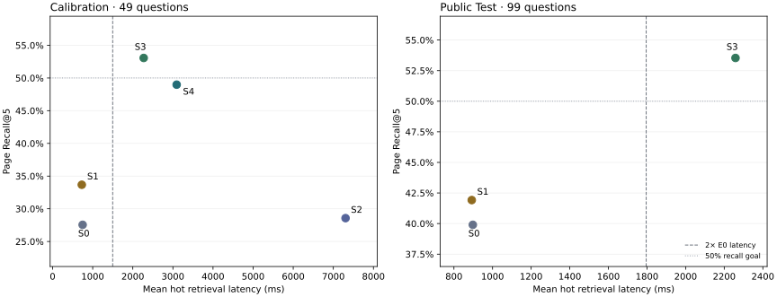

# A1-V3 FinanceBench 候选重排复评

## 协议和数据

实验基于 `7249c9eb3e0b8cbc7eb57a1f69a289613a7f8662`，在 `experiment/a1-retrieval-v3` 的独立 WSL worktree 执行。沿用 A1-V2 的 49 道共同可评测 Calibration、99 道公开 Test、83 份入库 PDF、36,622 个旧 Chunk、原分区与评分口径。原索引只用于校验和复制。新增索引构建数为 0，真实 GLM 请求和 Token 用量均为 0。99 道题已用于历史实验，本轮属于公开基准复评。

- **S0** 原 R3，Candidate-K 24，RRF k=60、等权。
- **S1** A1-V2，Candidate-K 50，RRF k=60，Dense/BM25 0.80/0.20，单页最多 1 个 Chunk。
- **S2** BM25 与 Dense 各 Top-50 的全集去重，原量化 MiniLM Cross-Encoder 在 CPU/ONNX 重排。
- **S3** 与 S2 的候选和原始 Query 完全相同，使用 BGE Cross-Encoder。
- **S4** BM25 与 Dense 各 Top-100 的全集去重，使用 BGE Cross-Encoder。
- **S5 条件组** 若 S3/S4 最优项的 Calibration Recall@5 低于 50% 且与候选 Oracle 相差至少 20 个百分点，仅对该组的 BGE logit 加固定的通用财务特征。期内年份只根据候选正文匹配，财报标题年份不当作表格期间，也不排除其他年份。其余特征是财务指标别名、报表类型和标题/章节词项。

S2–S4 将候选并集中的每个 Chunk 交给 Reranker。参考 RRF 排名仅供审计。并集 Recall 计算其覆盖的全部 Gold 页比例；Oracle Recall@5 将可覆盖 Gold 页数上限限制为 5，反映五个 Chunk 内的理论最优页召回。最终 Top-5 始终最多取五个 Chunk。排序接口只接收原始 Query、候选正文和预设元数据，Gold 页及官方证据摘录在排名归档之后才用于计分和数值行诊断。

配置按 Calibration Recall@5、Recall@1、MRR@10、完整行覆盖、热均值依次择优。部署候选需要 Recall@5 严格高于 E0，Recall@1、Recall@10、MRR 的下降各不超过 0.03，且冷热平均延迟分别不超过同环境 E0 两倍。冻结后仅复评 E0、A1-V2 和质量最优配置，相同配置只计一次。

## 硬件与计时

WSL RTX 4060 Laptop 8 GB，驱动 555.97。BGE 固定在 `953dc6f6f85a1b2dbfca4c34a2796e7dde08d41e`，safetensors SHA256 与官方发布一致。使用 PyTorch 2.14.0+cu126、Transformers 5.24.0、FP16、`torch.inference_mode`、最长 512 tokens，按长度分组后最多 24 对、8,192 个 padding tokens 一批。MiniLM 复用历史 Xenova ONNX 量化权重，修订 `a09144355adeed5f58c8ed011d209bf8ee5a1fec`，CPU 批量为 8。权重文件、依赖和数据指纹见冻结清单。[BAAI 模型卡](https://huggingface.co/BAAI/bge-reranker-v2-m3)

24 对合成样本预检中，MiniLM CPU 约 54.6 对/秒，BGE GPU 约 146.1 对/秒。BGE 峰值分配为 1,257,727,488 字节，峰值预留为 1,335,885,824 字节。耗时差包含 CPU/GPU、精度和实现差异。模型启动、加载索引和官方证据评分不计入延迟；生产进程若频繁重启需另外测量启动时间。

在 Calibration 中直接使用 A1-V2 缓存的原始候选排名。另跑不接触答案的冷、热候选计时，在同一次查询中复用资格范围、BM25 和查询向量的耗时，各 K 分别测量 Qdrant 查询。每组延迟是同一查询的 CPU 检索分项加该组真实排序耗时。冷测逐题清空公司范围缓存并首次写入独立向量缓存。热测复用同公司的合法范围和已编码 Query。Reranker 的冷热测均重新评分。计时审计比较候选 ID 顺序与冷测排名，浮点分数的末位差异不会触发失败。OS 文件缓存未清除。

## Calibration 结果（49 题）

| 组 | 平均候选数 | 并集召回 | Oracle@5 | Recall@1 | Recall@5 | Recall@10 | MRR@10 | nDCG@10 | Top-5 唯一页 | 完整行数 / 785 |
| --- | ---: | ---: | ---: | ---: | ---: | ---: | ---: | ---: | ---: | ---: |
| S0 | 43.4 | 67.35% | 67.35% | 10.20% | 27.55% | 43.88% | 0.176 | 0.236 | 4.55 | 139 |
| S1 | 87.3 | 81.29% | 81.29% | 14.29% | 33.67% | 45.92% | 0.238 | 0.281 | 5.00 | 204 |
| S2 | 87.3 | 81.29% | 81.29% | 7.14% | 28.57% | 43.88% | 0.205 | 0.244 | 4.43 | 184 |
| S3 | 87.3 | 81.29% | 81.29% | 21.43% | 53.06% | 65.31% | 0.376 | 0.432 | 4.63 | 374 |
| S4 | 165.0 | 89.46% | 89.46% | 21.43% | 48.98% | 65.31% | 0.365 | 0.425 | 4.67 | 322 |

49 道题在 K=24、50、100 上均复现 A1-V2 的候选 ID 顺序。此样本中可用 Gold 页没有超过五页的情况，因此并集召回和 Oracle@5 数值相同。S2/S3 的候选集合一致，S3 将 Recall@5 从 28.57% 提升至 53.06%，Top-5 的完整数值行从 184 增至 374。S4 的更大并集额外覆盖 43 条完整行，最终 Top-5 却少覆盖 52 条，Recall@5 比 S3 低 4.08 个百分点。S1 的单页配额相对同权重的无配额排序丢失 4 个完整行、增加 2 个。S2–S4 未使用页面配额。

| 组 | 候选池内成对 Gold 页数 | 参考 RRF 中位名次 | 重排后中位名次 | 提升 / 下降 |
| --- | ---: | ---: | ---: | ---: |
| S2 | 49 | 12 | 9 | 24 / 21 |
| S3 | 49 | 12 | 4 | 36 / 7 |
| S4 | 54 | 17.5 | 5.5 | 40 / 7 |

| 组 | 冷均值 / P50 / P95 (ms) | 热均值 / P50 / P95 (ms) | 热 Query-Chunk Pair/s | 峰值 GPU 分配 |
| --- | ---: | ---: | ---: | ---: |
| S0 | 1,897 / 1,834 / 3,273 | 749 / 402 / 2,069 | — | — |
| S1 | 1,848 / 1,776 / 3,208 | 728 / 397 / 2,009 | — | — |
| S2 | 8,018 / 7,790 / 11,188 | 7,305 / 7,202 / 10,755 | 13.3 | — |
| S3 | 3,397 / 3,392 / 5,020 | 2,272 / 1,984 / 3,645 | 56.8 | 1.24 GiB |
| S4 | 4,197 / 4,209 / 6,082 | 3,093 / 2,912 / 4,654 | 70.1 | 1.24 GiB |

五组均完成 49/49，零失败、零冷/热 Top-10 名次不一致，BGE 无显存超限拆批。冻结时选择 **S3 为质量最优配置**，热均值为 E0 的 3.03 倍，超出部署上限；选择 **S1 为延迟可接受候选**。S3 已过 50% 的预设筛选线，所以没有触发 S5。冻结文件 SHA256 为 `dd00c90dc3a0ce65bba15bf6321b9a1e25a3eb9b711709ba19abe979161bb2b7`，正式计划为 S0、S1、S3。


## 正式 Test 结果（99 题）

所有组均完成 99/99 题，无失败或剔除。S0 与 S1 的逐题页级指标分别与 A1-V2 归档 99/99 一致。

| 组 | Recall@1 | Recall@5 | Recall@10 | MRR@10 | nDCG@10 | 文档 Recall@5 | 并集召回 | Oracle@5 | Top-5 唯一页 | 完整行数 / 1,809 |
| --- | ---: | ---: | ---: | ---: | ---: | ---: | ---: | ---: | ---: | ---: |
| S0 | 18.18% | 39.90% | 48.99% | 0.290 | 0.335 | 98.99% | 67.17% | 67.17% | 4.73 | 603 |
| S1 | 19.70% | 41.92% | 49.49% | 0.309 | 0.350 | 97.98% | 79.29% | 79.29% | 5.00 | 693 |
| S3 | 30.81% | 53.54% | 64.14% | 0.449 | 0.484 | 97.98% | 79.29% | 79.29% | 4.73 | 877 |

| S3 配对比较 | Recall@5 差值（百分点） | 95% 公司聚类 Bootstrap 区间 | 改善 / 下降 / 持平 |
| --- | ---: | ---: | ---: |
| 相对 S0 | +13.64 | +3.33 至 +25.23 | 23 / 6 / 70 |
| 相对 S1 | +11.62 | +1.27 至 +23.16 | 20 / 6 / 73 |

区间用 21 家公司、固定种子和 10,000 次有放回重抽样计算，簇内保留全部题目。S3 在同一候选池内将 94 个 Gold 页对应项的中位名次从 9.5 提升到 2，其中 59 个名次改善、16 个下降。其完整财务行覆盖为 877/1,809（48.48%），高于 S0 的 603/1,809 和 S1 的 693/1,809。S1 的单页配额相对同样权重的无配额排序少保留 19 个可识别完整行，没有新增完整行。数值行采用官方页内摘录与 PDF 解析行的规范化子串匹配，是证据行覆盖代理，无法验证跨行表头绑定、符号、各列口径或答案正确性。

| 组 | 冷均值 / P50 / P95 (ms) | 热均值 / P50 / P95 (ms) | 热 Query-Chunk Pair/s | 峰值 GPU 分配 / 预留 |
| --- | ---: | ---: | ---: | ---: |
| S0 | 2,751 / 2,203 / 5,365 | 898 / 495 / 3,172 | — | — |
| S1 | 2,708 / 2,130 / 5,312 | 892 / 494 / 3,097 | — | — |
| S3 | 4,058 / 3,554 / 6,809 | 2,258 / 1,894 / 4,371 | 65.2 | 1.24 / 1.31 GiB |

S3 的平均并集为 88.61 个 Chunk。其热重排阶段平均用时 1,360 ms，冷、热总体均值分别为同环境 E0 的 1.47 倍和 2.52 倍。正式进程峰值 RSS 为 4,417,116 KiB，BGE 无显存超限拆批。各组冷、热候选 ID 顺序及重排 Top-10 一致。

**质量候选为 S3。** 它达到 50% 目标，相对 S0 和 S1 的配对区间均高于零。**延迟可接受候选为 S1。** S3 超出同环境热均值门槛，暂不建议作为默认实时检索器。S1 仍有页内互补信息损失，且相对 E0 的 Recall@5 配对区间含零。本实验分支提交离线证据，主线采用决定留给维护者。



## 验收和归档

全量 pytest 为 **264 passed、1 skipped**，包含 12 个新增回归。跳过项需要额外的本地 V2 Streamlit 集成快照。真实 GLM 请求和 Token 用量均为 **0**。

`freeze.json` 保存数据、原索引、候选缓存、代码、依赖和权重指纹，以及独立的正式运行计划。逐题归档只包含公开题目 ID、公司组指纹、得分、时延和计数。候选轨迹的六列依次为 Chunk 指纹、BM25 名次、Dense 名次、审计 RRF 名次、重排分数、最终名次。正式排名归档 SHA256 为 `9915e743d63b20005a984eadfa76a59bd118548c6c231539e4e4d5fddaf3b797`。可通过 `summary.json` 内的文件哈希核对发布产物。


## 复现

在独立 worktree 运行。使用 A1-V2 的本地候选缓存及原工作区的 FinanceBench 官方数据和索引。另选一个空的 `RUN` 目录。模型文件仅放在本地，正式重排全程离线。

```bash
SOURCE=/home/gaoyi/projects/tradingagents-lite
V2=/home/gaoyi/projects/tradingagents-a1-retrieval-v2
RUN=data/a1-retrieval-v3/replay-001
MODEL=data/a1-retrieval-v3/bge-reranker-v2-m3
BENCH=data/a1-retrieval-v3/benchmark-env
REV=953dc6f6f85a1b2dbfca4c34a2796e7dde08d41e
UV_PROJECT_ENVIRONMENT="$BENCH" uv sync --locked --python /usr/bin/python3
uv pip install --python "$BENCH/bin/python" \
  --extra-index-url https://download.pytorch.org/whl/cu126 --index-strategy unsafe-best-match \
  'torch==2.14.0+cu126' 'transformers==5.24.0'
mkdir -p "$MODEL"
for file in config.json model.safetensors sentencepiece.bpe.model special_tokens_map.json tokenizer.json tokenizer_config.json; do
  curl -fsSL "https://huggingface.co/BAAI/bge-reranker-v2-m3/resolve/$REV/$file" -o "$MODEL/$file"
done
CACHE="$V2/data/a1-retrieval-v2/001/candidate-cache.jsonl"
"$BENCH/bin/python" -m tradingagents_lite.retrieval_v3 probe --source "$SOURCE" --run "$RUN" --model "$MODEL"
"$BENCH/bin/python" -m tradingagents_lite.retrieval_v3 prepare --source "$SOURCE" --run "$RUN" --legacy-cache "$CACHE"
"$BENCH/bin/python" -m tradingagents_lite.retrieval_v3 calibrate --source "$SOURCE" --run "$RUN" --model "$MODEL"
"$BENCH/bin/python" -m tradingagents_lite.retrieval_v3 test --source "$SOURCE" --run "$RUN" --model "$MODEL"
mkdir -p /tmp/a1-retrieval-v3-report
uv run --locked --with matplotlib==3.11.2 python results/a1-retrieval-v3/export.py \
  --run "$RUN" --out /tmp/a1-retrieval-v3-report
```

测试使用主项目锁文件和既有离线夹具。先在独立 worktree 的 `data/` 复制 `yahoo-2024-v1`、`evidence-cache-001`、`financial-evidence-dev-003`、`a1-development-001`、`counterfactual-development-v1-001`，将原 `local-models/models` 复制到本地同名路径，再运行 `uv run --locked --offline --extra pdfium --group ui pytest -q -rs`。
