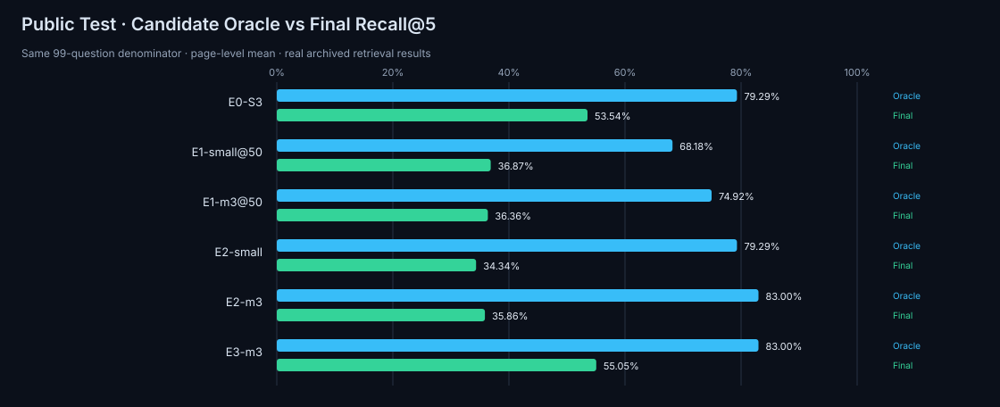
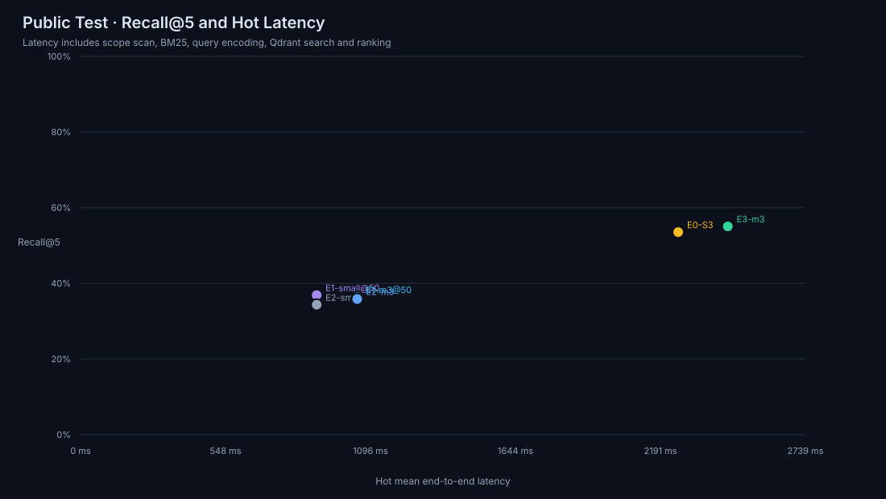

# A1-V4 Stronger Embedding Retrieval Ablation

## Result

The experiment uses the frozen A1-V3 base commit `ee7998438ffeee4d786eed46dcb925d1798afaf9` on branch `experiment/a1-retrieval-v4-embedding`. It uses BGE-M3 dense embeddings at revision `5617a9f61b028005a4858fdac845db406aefb181`, the unchanged BGE-small S3 control, the same BGE reranker as S3, and the existing 83-PDF / 36,622-chunk corpus. No model was trained and no GLM request was made.

The 49 shared Calibration questions select the configuration before formal Test. The 99-question FinanceBench public Test has been evaluated repeatedly in prior work and is not an unseen test set.

## Frozen setup and integrity

- Model: [BAAI/bge-m3](https://huggingface.co/BAAI/bge-m3), 1,024 dimensions, CLS pooling, L2 normalization, no query instruction prefix, dense only, `512` token limit, `cuda` inference.
- Pinned model revision: `5617a9f61b028005a4858fdac845db406aefb181`. Per-file SHA256 hashes are in `freeze.json`.
- Token lengths: mean `285.4`, P50 `312`, P95 `384`, P99 `443`, max `721`. `109/36622` chunks exceed 512 tokens (0.30%); `0/36622` exceed 1,024 (0.00%).
- New independent Qdrant collection: `chunks_bge_m3_v4`, cosine distance, `36,622` encoded chunks and `83` documents. Failed encodings: `0`. Payload/Chunk ID equality audit: `True`.
- Index size: `453,653,070` bytes. Build: `689.6s`, `53.1` chunks/s. Peak embedding VRAM allocated/reserved: `1,333,036,032` / `1,587,544,064` bytes.
- Qdrant versus exact cosine audit, `10` Calibration queries: top-100 overlap `100.00%`, top-10 overlap `100.00%`, top-1 equal `10/10`.
- The smoke test used `8` actual chunks: `1024`-d vectors, unit norms, repeat max absolute delta `0`, batch/single max delta `0.00026`, exact self-retrieval top-1 passed. Peak smoke VRAM `1,215,116,288` allocated / `1,256,194,048` reserved bytes.
- Query encoding uses CUDA; BM25 and local Qdrant search run on CPU. Qdrant query timing includes the synchronized GPU-to-host vector transfer. Model loading and reranker warm-up are recorded separately.

## Calibration selection

Calibration denominator: `49`. E4 was `skipped`. Selection was fixed as follows: best hybrid without reranker `E2-m3`, quality candidate `E3-m3`, deployment candidate `E0-S3`, best reranked candidate `E3-m3`.

| Arm | Candidate Oracle@5 | Recall@1 | Recall@5 | Recall@10 | MRR@10 | nDCG@10 | Hot mean |
|---|---:|---:|---:|---:|---:|---:|---:|
| E0-S3 | 81.29% | 21.43% | 53.06% | 65.31% | 0.376 | 0.432 | 2,271.9 ms |
| E1-small@50 | 76.53% | 11.22% | 28.57% | 44.90% | 0.211 | 0.261 | 728.1 ms |
| E1-m3@50 | 83.67% | 14.29% | 29.59% | 38.78% | 0.256 | 0.272 | 934.3 ms |
| E2-small | 81.29% | 11.22% | 26.53% | 41.84% | 0.188 | 0.235 | 728.2 ms |
| E2-m3 | 86.39% | 7.14% | 35.71% | 39.80% | 0.178 | 0.221 | 934.3 ms |
| E3-m3 | 86.39% | 21.43% | 53.06% | 69.39% | 0.381 | 0.447 | 2,284.4 ms |

## Public Test results

Test denominator: `99` / 99. Metrics use the same page-level mean recall, MRR@10 and nDCG@10 calculation as A1-V3. All 99 questions remain in the denominator. RRF is fixed at k=60 and equal weights; no weight grid was searched. E3 reranks the entire de-duplicated BM25@50 + dense@50 union before returning Top-5.

| Arm | Candidate Oracle@5 | Recall@1 | Recall@5 | Recall@10 | MRR@10 | nDCG@10 | Hot mean | Hot P95 |
|---|---:|---:|---:|---:|---:|---:|---:|---:|
| E0-S3 | 79.29% | 30.81% | 53.54% | 64.14% | 0.449 | 0.484 | 2,258.4 ms | 4,371.0 ms |
| E1-small@50 | 68.18% | 18.69% | 36.87% | 46.97% | 0.293 | 0.330 | 892.1 ms | 3,097.2 ms |
| E1-m3@50 | 74.92% | 18.69% | 36.36% | 47.47% | 0.279 | 0.319 | 1,045.2 ms | 3,091.8 ms |
| E2-small | 79.29% | 18.18% | 34.34% | 43.94% | 0.269 | 0.306 | 892.2 ms | 3,097.2 ms |
| E2-m3 | 83.00% | 20.71% | 35.86% | 41.92% | 0.285 | 0.311 | 1,045.4 ms | 3,092.0 ms |
| E3-m3 | 83.00% | 31.82% | 55.05% | 64.65% | 0.457 | 0.493 | 2,445.7 ms | 4,488.9 ms |

### Candidate-stage recall

Dense Recall@K is page-level recall among the first K Dense-ranked chunks, matching the A1-V3 page-level mean-recall convention. Candidate-pool page recall and the Top-5 oracle are shown separately for BM25, dense, and their de-duplicated union.

| Embedding | Dense R@1 | Dense R@5 | Dense R@10 | Dense R@24 | Dense R@50 | Dense R@100 | BM25@50 page recall | Dense@50 page recall | Hybrid union page recall | Hybrid Oracle@5 |
|---|---:|---:|---:|---:|---:|---:|---:|---:|---:|---:|
| BGE-small | 18.69% | 36.87% | 46.97% | 59.09% | 68.18% | Unavailable | 51.52% | 68.18% | 79.29% | 79.29% |
| BGE-M3 | 18.69% | 36.36% | 47.47% | 64.14% | 74.92% | 88.55% | 51.52% | 74.92% | 83.00% | 83.00% |

### Test interpretation

- **Embedding quality:** BGE-M3 Dense@50 page recall is 74.92%, up 6.74 percentage points from the archived BGE-small @50 result (68.18%). BGE-M3 Dense@100 is 88.55%; the archived BGE-small Test cache has no @100 results.
- **Candidate coverage:** the BGE-M3 BM25@50 + Dense@50 union reaches 83.00% Candidate Oracle@5, 3.71 points above S3's 79.29%; it remains below the 90% target. Mean de-duplicated candidate count is 89.38.
- **Final ranking:** E3-m3 reaches 55.05% Recall@5 versus S3's 53.54% (+1.52 points). Paired differences: 5 improved, 3 regressed, 91 tied; company-cluster bootstrap 95% CI is [-3.03, +5.34] points, which includes zero. E3 improves Recall@1/10, MRR@10 and nDCG@10 slightly. E2-m3 without reranking reaches only 35.86% Recall@5, showing that the unchanged reranker converts much of the candidate pool's value into Top-5 results.
- **Remaining loss:** E3 A/B/C gold-page counts are 66 in Top-5, 35 in the candidate pool but outside Top-5, and 21 absent from the pool. The numeric financial-line proxy is 889/1,809 (49.14%) for E3 versus 877/1,809 (48.48%) for S3.
- **Deployment:** Calibration retained E0-S3 because no V4 arm passed the Recall@5 quality gate. E3's hot mean is 2,445.7 ms versus S3's 2,258.4 ms (1.08x); cold mean is 4,286.3 ms versus 4,058.0 ms (1.06x), both below the 2x latency ceiling. The summary's `deployment_latency_gate.passed=true` means the retained E0 baseline itself is within the ceiling; it does not mean a V4 upgrade qualified.
- **Cold timing caveat:** an earlier formal-Test preflight completed the cold/hot candidate retrieval pass but failed before ranking because the archived small-model Test data lacked @100. It warmed the OS page cache. The final run's `cold` pass therefore means the experiment's company-scope cache was cleared; it is not a disk-cold measurement. The OS page cache was not evicted, consistent with the A1-V3 protocol limitation.
- **Freeze chronology:** `freeze-initial.json` records the freeze created before that preflight. The preflight emitted no rankings or metrics. Afterward, the cache-depth limitation was made explicit, Calibration was rerun on the same 49 questions with the same selection, and `freeze.json` was reissued with the final source fingerprint before successful scoring. No Test metric informed model or configuration selection.
- **Index serialization audit:** the local Qdrant persisted-vector SHA256 changed between the pre-close in-memory vector and the reopened persisted collection (`997b53c9…` to `dd62e04e…`). The persisted vectors passed finite/dimension/L2 checks, and Qdrant top-100 matched exact cosine 100% across 10 sampled Calibration scopes. The frozen fingerprint uses the reopened persisted vectors.





### Separating the three effects

- **Embedding retrieval:** compare `E1-small@50` with `E1-m3@50` in the pure Dense curve and `candidate_stages`. This isolates Dense candidate quality.
- **Candidate coverage:** compare the BM25@50, Dense@50 and de-duplicated hybrid union page recall / Oracle@5. `candidate_stages` reports each independently.
- **Final ranking:** compare E2 hybrid RRF (no reranker) with E3 BGE-M3 hybrid plus the unchanged reranker. A gap from Oracle@5 to final Recall@5 measures how much candidate coverage the final ordering fails to realize.

Per-arm paired improved/regressed/tied counts and company-cluster bootstrap 95% intervals are in `summary.json`; deidentified per-question deltas are in `summary.json` and `test-rows.jsonl`. Loss is attributed by gold page: A entered final Top-5, B was present in the candidate pool but missed Top-5, C was absent from the pool.

### Latency and resource details

`summary.json` reports cold and hot mean/P50/P95 for scope scan, BM25, query encoding, Qdrant search, fusion, reranking and end-to-end latency; each arm includes peak allocated/reserved GPU memory and OOM batch splits. The pinned model load time is `11.8s`; reranker load and warm-up are in `summary.json`. Cold follows the A1-V3 first retrieval pass and does not flush the OS cache. Model startup/warm-up costs are excluded from per-query latency.

### Limits and reproducibility

- FinanceBench's 99-question public Test is reused and is not an independent unseen test.
- Financial-line coverage is the same V3 numeric-line proxy; it is not a manually adjudicated XBRL metric.
- Cold timing follows V3's first retrieval pass with company scope cache cleared; OS page cache is not evicted.
- Model loading and reranker warm-up are reported separately and excluded from per-query cold/hot latency.
- Retrieval uses the original chunk payloads, BM25 implementation, Qdrant filters, and page-level mean recall.
- E4 Top-100 was skipped because the Calibration trigger did not identify candidate coverage as the dominant bottleneck.
- The archived V3 BGE-small Test cache ends at @50. BGE-small Dense@100 is reported Unavailable; the original Qdrant index and embedding cache were not queried or modified to reconstruct it.

GLM requests: `0`. GLM tokens: `0`. New Python package dependencies: none; the run reused the A1-V3 benchmark CUDA environment (PyTorch, Transformers, Hugging Face Hub, Qdrant client).

Run from the V4 worktree with the A1-V3 benchmark environment:

```bash
PY=/home/gaoyi/projects/tradingagents-a1-retrieval-v3/data/a1-retrieval-v3/benchmark-env/bin/python
$PY -m tradingagents_lite.retrieval_v4 prepare
$PY -m tradingagents_lite.retrieval_v4 calibrate
$PY -m tradingagents_lite.retrieval_v4 freeze
$PY -m tradingagents_lite.retrieval_v4 test
```

The Test command verifies the frozen source-code, model, calibration and index fingerprints before loading the 99 Test questions. Local model files, vectors, index and raw candidate caches stay under ignored `data/a1-retrieval-v4/001/`; they are not committed.
