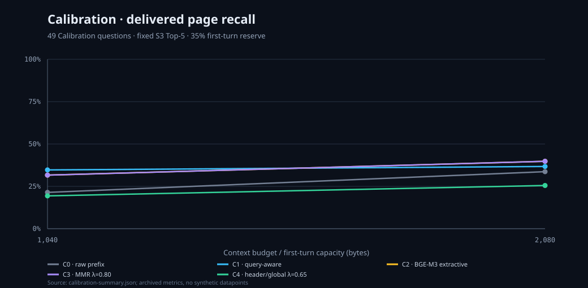
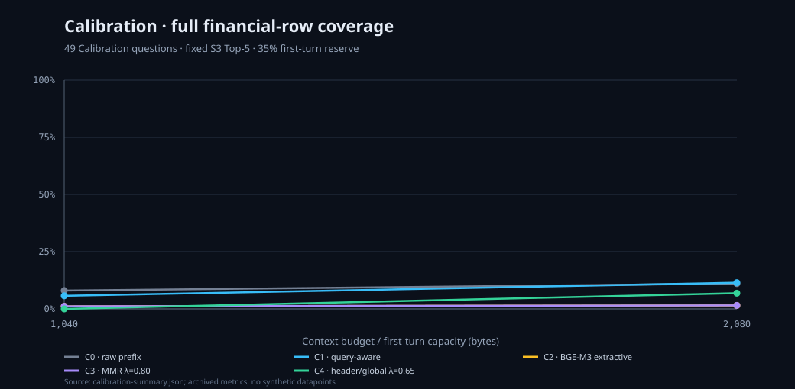
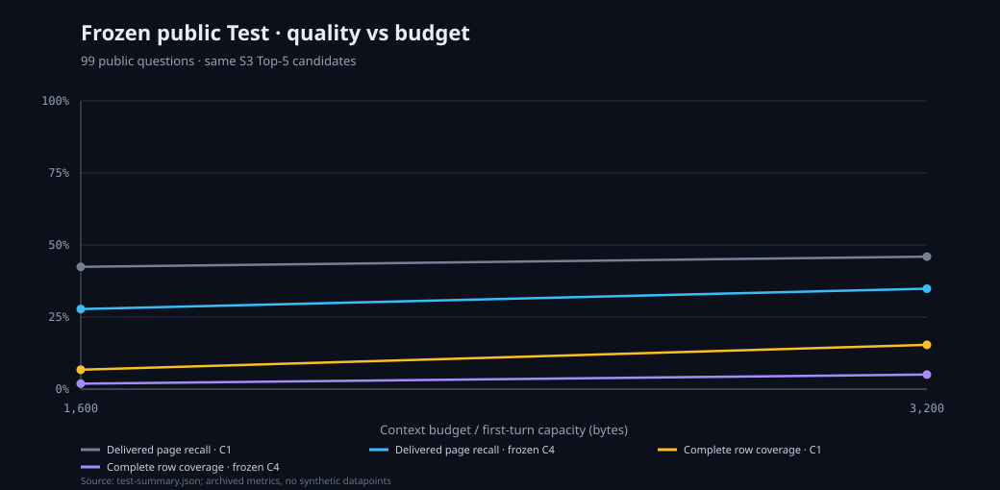

# A1-V5：Financial RAG Context Compression

## 结论

- Calibration 选择的新配置为 **C4（MMR λ=0.65）**；按相同质量排序，C1 仍是全组综合赢家。
- 固定 S3 Top-5 在公开 Test 的页级检索 Recall@5 为 **53.5%**。所有压缩组复用相同候选，检索 Recall 未改变。
- 3200-byte Test：C1 送达页召回 46.0%、完整财务行覆盖 15.4%；C4 分别为 34.8%、5.1%。
- C4 减少了上下文用量，但页级证据、完整财务行、年份、数值、单位保留都低于 C1。本轮没有证据支持替换现有压缩器，保留负结果。

## Calibration：49 题，固定 A1-V3 S3 Top-5

选择顺序：完整财务行覆盖、送达页召回、原文一致、表头绑定、延迟。答案和官方证据只在评分阶段使用。

### 3200-byte 主预算：质量

| Variant | Delivered page | Complete rows / total | Year | Values | Units | Header bound / attempts | Citation | Source exact |
| --- | ---: | ---: | ---: | ---: | ---: | ---: | ---: | ---: |
| C0 raw prefix | 33.7% | 29/262 (11.1%) | 29.5% | 17.1% | 23.9% | 0/0 (N/A) | 100.0% | 100.0% |
| C1 current query-aware | 36.7% | 30/262 (11.5%) | 36.6% | 14.9% | 31.2% | 0/0 (N/A) | 100.0% | 100.0% |
| C2 BGE-M3 extractive | 39.8% | 4/262 (1.5%) | 5.4% | 1.1% | 5.8% | 1/2 (50.0%) | 100.0% | 100.0% |
| C3 λ=0.80 | 39.8% | 4/262 (1.5%) | 5.4% | 1.1% | 6.5% | 1/2 (50.0%) | 100.0% | 100.0% |
| C4 λ=0.65 | 25.5% | 18/262 (6.9%) | 13.4% | 2.2% | 7.2% | 4/4 (100.0%) | 100.0% | 100.0% |

### 3200-byte 主预算：上下文与耗时

| 配置 | 平均上下文 bytes | 平均请求 / 最大请求 bytes | 来源压缩比 | BGE tokenizer 代理 tokens | 选择均值 / P95 ms | embedding 均值 ms | 超预算题数 |
| --- | ---: | ---: | ---: | ---: | ---: | ---: | ---: |
| C0 raw prefix | 2076.8 | 2919.7 / 3146 | 24.8% | 433.8 | 3.6 / 7.7 | 0.0 | 0 |
| C1 current query-aware | 1944.6 | 2787.5 / 3142 | 21.8% | 384.6 | 21.4 / 49.8 | 0.0 | 0 |
| C2 BGE-M3 extractive | 1488.4 | 2331.2 / 2921 | 11.6% | 216.4 | 270.0 / 356.6 | 256.8 | 0 |
| C3 λ=0.80 | 1487.3 | 2330.1 / 2921 | 11.5% | 216.5 | 271.8 / 362.8 | 256.8 | 0 |
| C4 λ=0.65 | 1932.6 | 2775.4 / 3142 | 18.2% | 355.7 | 276.8 / 366.8 | 256.8 | 0 |

### 1600-byte 压力预算：C1 与最佳新配置

| Variant | Delivered page | Complete rows / total | Year | Values | Units | Header bound / attempts | Citation | Source exact |
| --- | ---: | ---: | ---: | ---: | ---: | ---: | ---: | ---: |
| C1 current query-aware | 34.7% | 15/262 (5.7%) | 20.5% | 4.2% | 15.2% | 0/0 (N/A) | 100.0% | 100.0% |
| Frozen-new C4 | 19.4% | 0/262 (0.0%) | 4.5% | 0.7% | 1.4% | 0/0 (N/A) | 100.0% | 100.0% |

| 配置 | 平均上下文 bytes | 平均请求 / 最大请求 bytes | 来源压缩比 | BGE tokenizer 代理 tokens | 选择均值 / P95 ms | embedding 均值 ms | 超预算题数 |
| --- | ---: | ---: | ---: | ---: | ---: | ---: | ---: |
| C1 current query-aware | 927.7 | 1770.6 / 2099 | 7.5% | 132.8 | 19.0 / 39.9 | 0.0 | 0 |
| Frozen-new C4 | 933.0 | 1775.9 / 2083 | 7.0% | 141.9 | 266.1 / 347.5 | 256.8 | 0 |

## 冻结公开 Test：99 题

公开 FinanceBench Test 已在此前 A1 迭代多次复评，不是独立未见集。本轮配置冻结后只评测一次，99 题全数留在分母。

### 3200-byte 主预算：质量

| Variant | Delivered page | Complete rows / total | Year | Values | Units | Header bound / attempts | Citation | Source exact |
| --- | ---: | ---: | ---: | ---: | ---: | ---: | ---: | ---: |
| C1 current query-aware | 46.0% | 73/475 (15.4%) | 45.8% | 18.3% | 37.4% | 0/0 (N/A) | 100.0% | 100.0% |
| Frozen C4 λ=0.65 | 34.8% | 24/475 (5.1%) | 14.2% | 2.8% | 11.8% | 0/1 (0.0%) | 100.0% | 100.0% |

### 3200-byte 主预算：上下文与耗时

| 配置 | 平均上下文 bytes | 平均请求 / 最大请求 bytes | 来源压缩比 | BGE tokenizer 代理 tokens | 选择均值 / P95 ms | embedding 均值 ms | 超预算题数 |
| --- | ---: | ---: | ---: | ---: | ---: | ---: | ---: |
| C1 current query-aware | 1949.4 | 2811.4 / 3208 | 21.7% | 394.9 | 22.6 / 47.0 | 0.0 | 0 |
| Frozen C4 λ=0.65 | 1814.3 | 2676.4 / 3206 | 17.2% | 326.2 | 199.6 / 336.2 | 184.8 | 0 |

### 1600-byte 压力预算

| Variant | Delivered page | Complete rows / total | Year | Values | Units | Header bound / attempts | Citation | Source exact |
| --- | ---: | ---: | ---: | ---: | ---: | ---: | ---: | ---: |
| C1 current query-aware | 42.4% | 32/475 (6.7%) | 35.6% | 4.7% | 25.2% | 0/0 (N/A) | 100.0% | 100.0% |
| Frozen C4 λ=0.65 | 27.8% | 9/475 (1.9%) | 8.0% | 1.0% | 6.4% | 0/1 (0.0%) | 100.0% | 100.0% |

| 配置 | 平均上下文 bytes | 平均请求 / 最大请求 bytes | 来源压缩比 | BGE tokenizer 代理 tokens | 选择均值 / P95 ms | embedding 均值 ms | 超预算题数 |
| --- | ---: | ---: | ---: | ---: | ---: | ---: | ---: |
| C1 current query-aware | 916.8 | 1778.8 / 2298 | 7.2% | 134.6 | 20.4 / 41.2 | 0.0 | 0 |
| Frozen C4 λ=0.65 | 890.5 | 1752.6 / 2230 | 6.7% | 132.4 | 191.7 / 326.4 | 184.8 | 0 |

## 方法、冻结与范围

- BGE-M3 revision 5617a9f61b028005a4858fdac845db406aefb181；1024 维 dense-only、CLS pooling、L2 normalization、FP16 CUDA；设备 NVIDIA GeForce RTX 4060 Laptop GPU；输入上限 512 tokens。
- C0 原文顺序前缀；C1 原 FinanceBench V2 Query-aware selection（CaseSearch._deliver）；C2 语义提取；C3 加 MMR；C4 加表头绑定与跨候选全局预算。
- 每题复用原问题、S3 查询和同一冻结 Top-5 chunk；无新检索、无 reranker 改动。所有事实 span 均可回溯到原文，document/page/evidence 引用完整。
- 主预算 3200 bytes，35% 首轮预留后 2080 bytes；压力预算 1600 bytes，首轮有效 1040 bytes；完整请求最多 8000 bytes。
- tokenizer 数量是 BGE-M3 代理，不代表真实 GLM token 节省。Top-10 按预设门槛跳过：Calibration 仅节省约 12 bytes，低于 100 bytes。
- GLM 请求 0、GLM Token 0；无训练、无模型下载；未访问 Private Test Gold 或 V3 Holdout；原索引只读。
- Freeze SHA256 d241cbfc037f296186b873eb49d881f82123f89826caee3f799c2b295f8c41e0。

## 产物

- summary.json：各组聚合指标；freeze.json：配置与数据/代码指纹。
- calibration-rows.jsonl 与 test-rows.jsonl：脱敏逐题指标，无原文、公司名或来源 URL。
- 图表由真实归档 JSON 渲染：quality-budget.svg、quality-budget-rows.svg、frozen-test-comparison.svg。
- COMMANDS.md 包含离线复现命令；render_artifacts.py 使用 Python 标准库生成图表和本报告。

## 测试与限制

- 99 题评测与所有 396 条逐题预算/配置行均已落盘；内置 matplotlib 导出因环境缺包退出，随后由标准库 renderer 从同一 JSON 生成报告与 SVG，未重跑或改写评测。
- 新增不变量测试 7 passed；不含数据归档用例的安全回归子集 147 passed、2 skipped。
- 完整 pytest：239 passed、2 skipped、15 failed、13 errors。失败/错误来自隔离 worktree 缺少 Yahoo 与 counterfactual development 测试 manifests；未补拷受保护数据。
- 财务行覆盖是基于公开证据全文/摘录的字符串匹配代理；压缩质量不能直接推断真实模型 QA 准确率。
- 当前 C2/C3/C4 没有胜过 C1；真实 GLM 验证需独立预算授权。

## 图表

