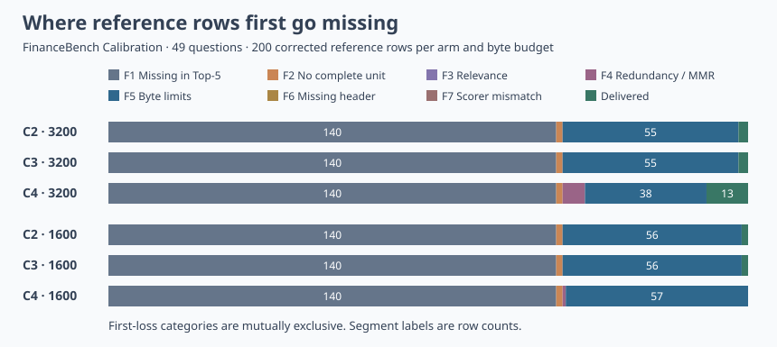
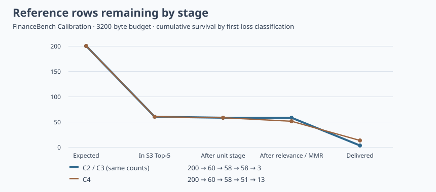

# A1‑V5.1 · RAG 上下文压缩失败归因

**保留 C1，结束本轮 A1 压缩搜索。** 只使用原 49 道 Calibration 题和冻结的 S3 Top‑5。D1 虽能在合成用例中保护财务行，但两档预算的实际送达内容与 C1 逐题一致。C4 在修正行标签后多覆盖 1 条，送达页召回下降 11.22 个百分点，平均耗时约为本次 D0 的 12 倍。没有候选达到采纳门槛。

本轮读取了公开 Calibration 的证据标签，用于独立归因和评分。99 道公开 Test 题未打开或复评。Gold 未传给检索、切分、排序或压缩函数。原索引未打开，直接复用经哈希核验的冻结候选；真实 GLM 请求 **0**，Tokens **0**。真实 Private Test 与 V3 Holdout 均未访问。

## 1. 为什么 C2、C3、C4 退化

- **最早的共有限制是候选。** 修正后 200 个财务行代理中，140 个在 S3 Top‑5 本来就没有完整对应片段。60 个可见代理中，58 个能落入至少一个完整证据单元，说明切分仍有缺口，但不是送达退化的主因。
- **C2 的主因是单候选字节上限。** 3200 档扣除 35% 后首轮为 2080 bytes，5 个候选的固定份额为 416 bytes。55 条原本有完整单元的代理行在份额检查遇阻，其中 24 条在早先某一步可装入，随后被同候选已选内容挤出。共有 31 条同时在至少一步遇到全局上下文或请求字节限制。上述关联计数会重叠。Evidence ID、文档、页码和 JSON 转义占用的是同一份额。
- **C3 的 MMR 没有缓解份额限制。** 3200 档共选 334 个单元，C2 为 328 个，然而页召回和完整行覆盖相同。两组不是完全相同的上下文，主要质量指标相同是两组都受同一份额限制。
- **C4 的短片段偏好与全局容量竞争叠加。** C4 去掉单候选硬份额，按相关性除以新增字节贪心选取。3200 档 38 条归为 F5 的修正目标此前全部可装入，随后被已选内容占用容量。另有 7 条首先遭遇 MMR 或重叠排除。C4 共选 473 个单元，其中仅 4 个带有表格行标记。相较 C1，C4 送达页更少，使用的上下文容量仍接近上限。
- **低相关性未成为单独的首次损失。** 首次分类中 F3 为 0，不能推断排序有效。可装入的完整单元后续因其他片段占用空间而落入 F5，排序是相关因素。C4 的 7 条 F4 是可复现的实际排除；其中有正的独立相关性、加 MMR 后变为非正的实例。

## 2. 首次损失与评分器审计

重放了 C2、原冻结推荐的 C3 λ=0.8 和 C4 λ=0.65，两个预算共 **294** 份送达。选中证据、正文与原文位置均逐项匹配原 Calibration 归档。没有试验新的 λ。

每个参考行按冻结试题和页码定位，记录首个终止原因。F1 是固定候选内没有完整匹配，F2 是存在原文跨度但全部单元缺失完整跨度。若有完整单元，实际被预算拒绝的路径归 F5，只有去重或 MMR 排除的归 F4，仅相关性无法进入选择的归 F3。F6 检查原文可验证列头在送达阶段是否缺失，F7 检查源跨度已经完整送达但旧评分漏认。成功跨单元合并送达的片段越过 F2。所有同时出现的条件单独记录，首次分类只计一次。

旧分母 262 包括 **58 条纯日期片段和 4 条章节编号或标题**。根因在于标签生成重用了宽松的切分器，将含数字的部分表头或段落也当成财务行。旧口径看似有 20 条在切分丢失，其中 18 条属于修正口径排除的日期/标题。新的 200 条分母只排除可确定的日期和章节，仍是标签代理，未对所有剩余片段逐条做财务专家标注。OCR、标点变化或原始表格映射错误仍可能影响对齐。

修正评分使用原文位置与比较后的词元序列，规范空白和点状引导符，保留数值符号、小数和括号，且禁止把跳过原文的多个片段拼接为一条完整行。按原分母比较，未发现已送达完整跨度但旧文本匹配漏记的 F7。修正年份、数值和单位保留率按对应页与完整词元匹配，避免子串命中，所有组适用统一规则。

**3200 bytes，每组均为修正分母 200：**

| 组别 | F1 候选 | F2 切分 | F3 相关性 | F4 重复 / MMR | F5 预算 | F6 表头 | F7 漏分 | 送达 |
|---|---:|---:|---:|---:|---:|---:|---:|---:|
| C2 | 140 | 2 | 0 | 0 | 55 | 0 | 0 | 3 |
| C3 | 140 | 2 | 0 | 0 | 55 | 0 | 0 | 3 |
| C4 | 140 | 2 | 0 | 7 | 38 | 0 | 0 | 13 |

F6 的零只适用于“已送达整行且同候选存在可验证列头”的检测范围。表头稀缺、模糊或落在其他候选时，不能据此认为达成表头覆盖。1600 档修正送达为 C2、C3 各 2 条、C4 0 条。原口径、修正口径及全部事件见 [failure-attribution.json](failure-attribution.json)。

### 脱敏例子

- `38dfb6c65e908be3fff8bc0e` · 第 64 个旧参考片段，仅包含月份与日期，曾被计为 F2，修正后从分母排除。
- 同题第 40 个修正参考片段有一个完整候选单元，C2 原始相关性约 0.459。先可装入、后触及单候选份额，归 F5。C4 同一片段也曾可装入，最终触及总容量。
- 同题第 68 个修正参考片段有完整候选单元，C4 独立相关性约 0.467。曾可装入，随后 MMR 降到非正，归 F4。
- `30a4cdcd7b18e9f307854e77` · 第 2 个参考片段在候选原文跨多个句式分段，无法装入单一切分单元，归 F2。该片段是带数字的叙述，说明保留分母仍是财务证据代理，不能当作逐条审定的表格真值。

### Evidence Unit 长度与边界

245 个固定候选均为平铺文本，没有换行。原 [chunk_document](../../tradingagents_lite/documents.py) 对词元使用空格连接，即便 PDF 有真实换行，送到 V5 切分器时也无法通过 `splitlines()` 恢复行。这里只能确认固定候选的状态，不能分离 PDF 抽取器本身的责任。平铺后，点状引导符的财务行、无引导符的长平铺块与普通句子由启发式处理。这会丢掉完整语境或选出接近无语义的短单元。

| 量度 | 数量 | 最小 / P50 / P95 / 最大 |
|---|---:|---|
| Evidence Unit UTF‑8 bytes | 1,416 | 2 / 141 / 1,459 / 1,720 |
| BGE‑M3 代理输入 tokens | 1,416 | 3 / 34 / 328 / 533 |

4 个单元超过 512 token 编码上限，编码发生截断。完整度归因中，旧分母的 96 个原文可见跨度有 76 个仍在完整单元中；修正后是 60 中 58。小数点加后续空白及大写或左括号会触发原句式正则，逗号与括号负数不直接触发该正则。未发现可确认的真实个位、小数或括号负号被拆开的已送达实例。合成回归覆盖这些数值边界。

## 3. 为什么表头尝试数偏低

| Calibration 埋点 | 次数 |
|---|---:|
| 原 V5 宽松表头提示命中 | 276 |
| 独立期间提示 / 单位提示命中 | 237 / 90 |
| 被识别为表格行的 Evidence Unit | 123 |
| 走到同候选邻近表头绑定检查 / 通过旧规则 | 1 / 1 |
| 直接继承前一行旧绑定 | 20 |
| 无邻近旧规则提示 | 102 |
| 旧规则视为已绑定 / 可独立复核列对应关系 | 21 / 1 |
| C4 3200 最终选中表格标记单元 / 旧规则标记绑定 | 4 / 4 |
| C4 1600 最终选中表格标记单元 / 旧规则标记绑定 | 0 / 0 |

旧归档的 `header_binding_attempts` 来自最终选中的 `table_row`，并非绑定器尝试次数；且 `bound` 可以来自继承，不保证年份列和数值列一一对齐。原历史 Test 的 1 次、0 成功不能推出全程只尝试一次。修正判定要求同候选可匹配的期间、列数及原文跨度；20 个旧绑定未能独立验证，不直接判定为错误。检查了正确行在另一同页 Top‑5 候选是否同时有期间提示，本轮可见目标中没有观察到。这不排除表头落在候选池之外。

人工核验小样本使用冻结候选顺序，每类审看前五条提示。对于 As of，先要求邻近两个年份及财务语境。共 20 条提示，其中 12 条被认为是表头提示，旧正则识别 7 条（58.3%，提示级，允许同一表头有多个提示）。5 处 **Years ended** 形式均未命中期间子式；同一处表头仍可能因 `in thousands` 被检出。Fiscal year 和 As of 会匹配叙述中的日期，样本的 8 条叙述提示均被旧正则接受。核验结果只用于解释规则，不用于调参或估计整体表头召回。补充检查确认旧单位正则可捕捉 `USD thousands` 及 `$ in millions` 的 `in millions` 子串，但单独的 `$ millions` 可能因货币符号前的词边界要求失配。

## 4. 最小修正对照

D0 逐题逐预算与原 C1 送达内容完全一致。D1 保留 C1 的关键词、短语、数值行及局部窗口排序。仅在选项跨到可定位的财务行时，优先尝试完整原文边界和可复核的同候选表头；尝试放不进即回退 C1 原选项。两组共用首轮 35% 预留（2080 / 1040 bytes）及 8000-byte 请求上限。没有运行 D2，原独立编码耗时本身超过部署延迟门槛，且 C2/C3 未显示可靠行覆盖收益。D3 无组合收益前提，未运行。

| 组别 | 预算 bytes | 送达页召回 | 完整行旧口径 | 完整行修正口径 | 年份 / 数值 / 单位保留（修正） | 可核查列头 | 上下文 bytes | 代理 tokens | 延迟 Mean / P95 ms |
|---|---:|---:|---:|---:|---|---:|---:|---:|---:|
| C2 | 3200 | 39.80% | 4/262 | 3/200 | 4.41% / 1.03% / 4.91% | 0 | 1488 | 216.4 | 269.99 / 356.65 |
| C3 | 3200 | 39.80% | 4/262 | 3/200 | 4.41% / 1.07% / 5.52% | 0 | 1487 | 216.5 | 271.78 / 362.77 |
| C4 | 3200 | 25.51% | 18/262 | 13/200 | 11.03% / 2.17% / 6.13% | 1 | 1933 | 355.7 | 276.83 / 366.81 |
| D0 | 3200 | 36.73% | 30/262 | 12/200 | 30.15% / 13.20% / 25.77% | 0 | 1945 | 384.6 | 22.30 / 50.98 |
| D1 | 3200 | 36.73% | 30/262 | 12/200 | 30.15% / 13.20% / 25.77% | 0 | 1945 | 384.6 | 28.26 / 74.21 |
| C2 | 1600 | 31.63% | 3/262 | 2/200 | 3.68% / 0.68% / 3.07% | 0 | 792 | 73.6 | 262.81 / 341.42 |
| C3 | 1600 | 31.63% | 3/262 | 2/200 | 3.68% / 0.57% / 3.07% | 0 | 796 | 73.9 | 262.84 / 341.32 |
| C4 | 1600 | 19.39% | 0/262 | 0/200 | 3.68% / 0.68% / 1.23% | 0 | 933 | 141.9 | 266.06 / 347.53 |
| D0 | 1600 | 34.69% | 15/262 | 2/200 | 16.91% / 3.31% / 12.88% | 0 | 928 | 132.8 | 21.44 / 47.75 |
| D1 | 1600 | 34.69% | 15/262 | 2/200 | 16.91% / 3.31% / 12.88% | 0 | 928 | 132.8 | 24.52 / 51.53 |

全部组的引用合法性与原文一致性均为 100%，预算违规为 0。表中代理 tokens 来自本地 BGE‑M3 tokenizer，只计证据文本。C2–C4 时延沿用旧归档，含本地嵌入和记账。D0/D1 在相同进程交错测量，均排除评分用 tokenizer 记账。原口径的年份、数值、单位保留和逐组最大请求字节数均在 summary.json。

### 对 D0 的逐题配对

配对按公司重采样 4,000 次。比例差单位为百分点，改/降/平按可评分的题统计。页召回是 49 题均值，修正行覆盖按行数计算，其中 29 题至少有一个合格标签。

| 组别 | bytes | 页召回差 [95% 区间] | 改/降/平 | 完整行差 [95% 区间] | 改/降/平 |
|---|---:|---:|---:|---:|---:|
| C2 | 3200 | +3.06 [-7.03, +13.51] | 7/6/36 | -4.50 [-15.22, -0.29] | 1/5/23 |
| C2 | 1600 | -3.06 [-15.74, +12.75] | 8/9/32 | +0.00 [-1.55, +0.95] | 1/1/27 |
| C3 | 3200 | +3.06 [-7.03, +13.51] | 7/6/36 | -4.50 [-15.22, -0.29] | 1/5/23 |
| C3 | 1600 | -3.06 [-15.74, +12.75] | 8/9/32 | +0.00 [-1.55, +0.95] | 1/1/27 |
| C4 | 3200 | -11.22 [-24.47, +0.00] | 5/11/33 | +0.50 [-12.17, +6.32] | 5/4/20 |
| C4 | 1600 | -15.31 [-31.11, +2.22] | 6/13/30 | -1.00 [-3.11, +0.00] | 0/2/27 |
| D1 | 3200 | +0.00 [+0.00, +0.00] | 0/0/49 | +0.00 [+0.00, +0.00] | 0/0/29 |
| D1 | 1600 | +0.00 [+0.00, +0.00] | 0/0/49 | +0.00 [+0.00, +0.00] | 0/0/29 |

D1 两档均为 0 个上下文变化，因此配对差与区间均为 0。该结果不能外推到不同数据、索引或问题的分布。

## 5. 测试、交付与停止

- 空工作树固定基线复现 **239 通过、2 跳过、15 失败、13 错误**。错误指向未随 worktree 迁移的历史行情、合成 Counterfactual Development fixture 和离线模型文件。
- 补足这些合法 fixture 后，尚需 A0.5 财务证据快照与项目自己的 `.venv/bin/python` 来启动隔离测试。全部补齐、保持测试原样后，原代码 **266 通过、3 跳过**，新代码 **277 通过、3 跳过**。新增 11 项回归通过。第三项跳过是原有真实 MCP 测试的环境开关条件。
- 原文定位、表头绑定、年份与正负号、预算、引用、未来时点及旧评分标签均有离线回归。源代码、冻结记录、预算和候选范围见 [freeze.json](freeze.json)，分组统计和配对区间见 [summary.json](summary.json)。匿名逐题跟踪及消融分别见 [cases.jsonl](cases.jsonl) 和 [ablation-rows.jsonl](ablation-rows.jsonl)。复现见 [COMMANDS.md](COMMANDS.md)。
- **最终建议保留 C1，正式结束 A1 系列本轮检索与压缩调参。** D1 没有实际收益。修正口径下 C4 的 1 条额外送达没有跨过 10% 门槛，且页召回损失与延迟超出预设限制。小样本配对区间不给 C4 的行覆盖改善提供可靠证据。本轮没有可进入后续评测的配置。
