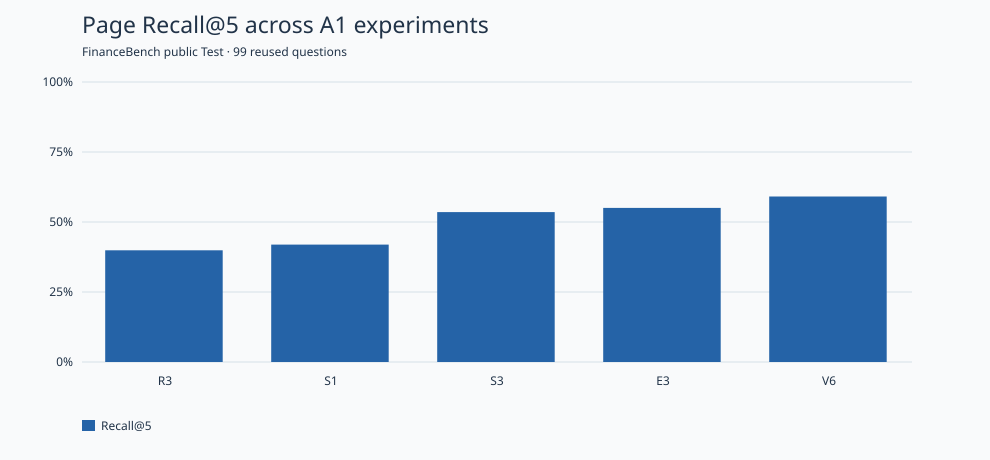
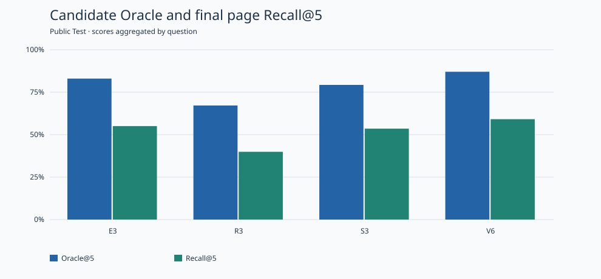
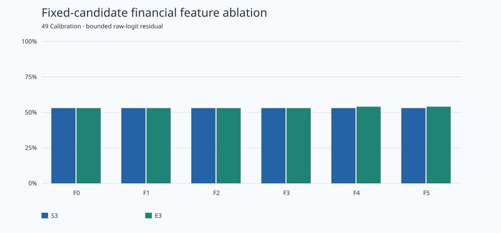
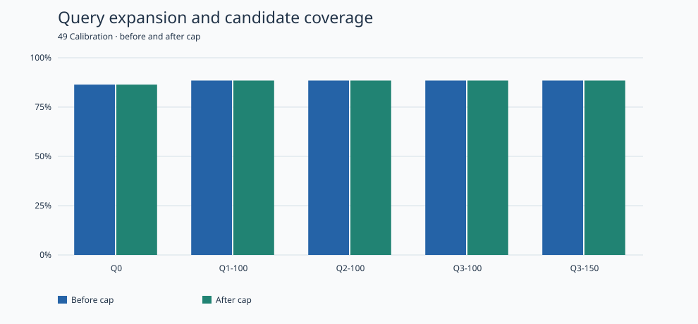
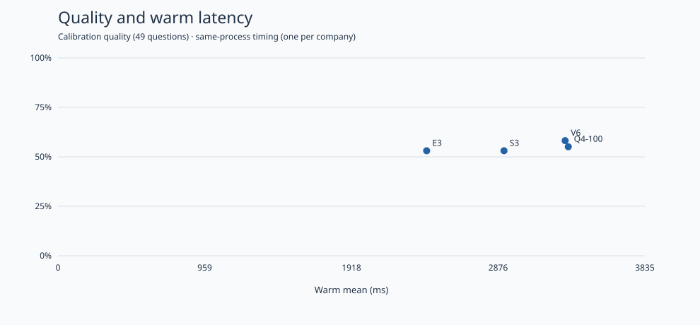
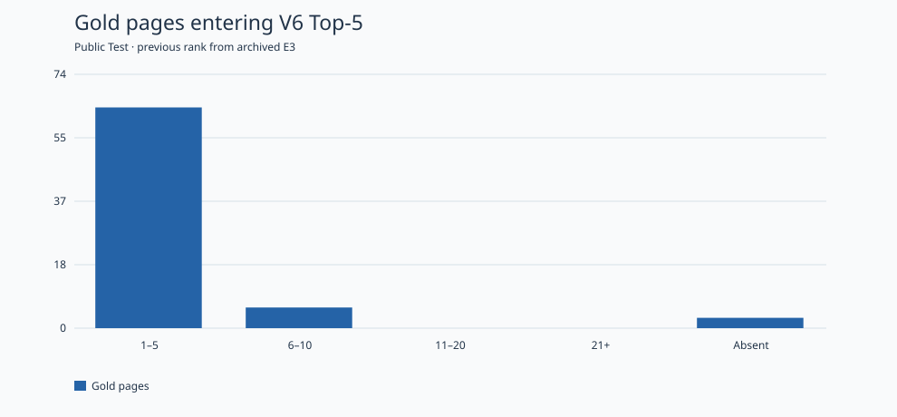
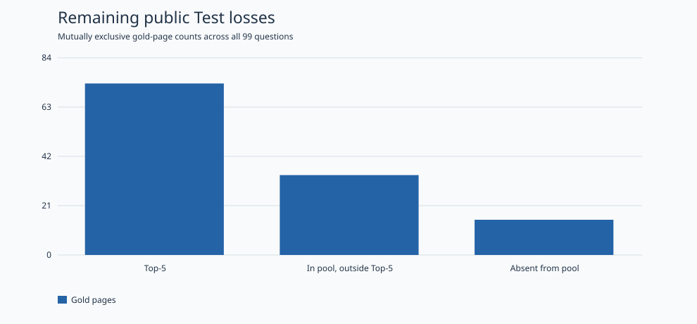

# A1-V6 Financial-aware Retrieval and Reranking Optimization

**冻结配置 Q4-150/F5-weighted-distinct 在 99 道公开 Test 的 Page Recall@5 为 59.09%，未达到 70% 目标。** Candidate Oracle@5 为 87.04%，与最终召回相差 27.95 个百分点。

同进程 Calibration 延迟对照中，V6 的热均值为 S3 的 1.14 倍，通过预注册的 1.25 倍部署门槛。生产替换还需要独立泛化验证。公开 99 题已多次用于 A1 历史实验，本轮在配置冻结后只评分一次。

达到延迟上限的实测配置包括 S3、E3、Q4-100/F5-weighted-distinct、Q4-150/F5-weighted-distinct。

## 校准与模块消融

同一套 49 题、11 家公司。所有规则都只读取问题与候选原文。留一公司选择用其余公司选择固定配置，再在被留出的公司评分。逐题结果保留全部固定配置和 OOF 选中记录。C1 上下文选择不变。

- **Phase 0/1**。S3 与 E3 固定池分别为 53.06% 和 53.06%。金融特征最高 54.08%（E3/F5-residual-none），该阶段 OOF 为 47.96%。语义保底，年份来自正文且仅作软分。
- **Phase 2**。Q4-150/F5-weighted-distinct 达到 58.16%，Oracle 从 86.39% 到 88.44%。该阶段 OOF 为 58.16%。原问保留，两路以加权 RRF 合并后按 Chunk ID 去重。
- **Phase 3**。83 份原 PDF 中重新解析 2,473 页，写入 7,665 个额外证据单元，其中 2,499 个财务行、1,399 个表块、273 条经布局对齐的绑定。T4/F5-weighted-distinct 达到 56.12%，Oracle 95.58%。未识别或不适合绑定的内容保留旧 Chunk。表头验证只保证版面对应，无法审计所有财报会计语义。
- **Phase 4**。手工特征相对原排序最多只在 2 家公司获得正向净改善，未达拟合门槛。未训练 Learning-to-Rank。
- **冻结**。全量 Calibration 选择 Q4-150/F5-weighted-distinct，召回 58.16%，全部候选共同参与的留一公司选择 OOF 为 58.16%。固定选择规则优先 Recall@5，再比较 Recall@1、MRR、财务行覆盖与候选规模。

扩展同池对照中，原 BGE 从 53.06% 变为 53.06%，金融重排将其提高至 58.16%，是本轮最大的最终召回改善。固定 E3 候选内，金融特征只从 53.06% 提高到 54.08%。结构索引扩大了覆盖，但扩大覆盖的部分仍需要更好的排序才能进入前 5。

保留当前 S3。V6 可作为后续端到端验证的研究候选，现有 S3/E3 的配对区间与独立泛化证据仍不足以支持替换。延迟门槛是相对的，基于每公司一题的顺序测量，实际部署还需按业务服务目标验证 P95。

首次冻结预检在加载公开题前报错，保留 freeze-preflight.json。正式 99 题预测保存后，旧 V3 汇总字段不兼容，由标准化导出脚本从原预测恢复。两次修复均未更改选定配置或重复运行公开检索。

## 冻结公开复评

| 配置 | Recall@1 | Recall@5 | Recall@10 | Oracle@5 | MRR@10 | nDCG@10 | Document Recall@5 | Top-5 唯一页 |
| --- | ---: | ---: | ---: | ---: | ---: | ---: | ---: | ---: |
| E3 | 31.82% | 55.05% | 64.65% | 83.00% | 0.457 | 0.493 | 95.96% | 4.71 |
| R3 | 18.18% | 39.90% | 48.99% | 67.17% | 0.290 | 0.335 | 98.99% | 4.73 |
| S3 | 30.81% | 53.54% | 64.14% | 79.29% | 0.449 | 0.484 | 97.98% | 4.73 |
| V6 | 36.36% | 59.09% | 65.66% | 87.04% | 0.496 | 0.521 | 100.00% | 4.80 |

- **对 E3 的配对差**为 +4.04 个百分点，公司聚类 95% CI [-0.48, +8.46]。对 S3 为 +5.56 点，改/降/平为 12/3/84，95% CI [-0.57, +10.71]。
- **覆盖与排序**。相对 E3，Oracle 变化 +4.04 点，最终召回变化 +4.04 点。两者不同，前者度量候选潜力，后者取决于最终排序。V6 的 Gold 页计数为 Top-5 73、池内未入 Top-5 34、池外 15。
- **完整行**。V3 口径 Top-5 986/1,809；V5.1 风格严格口径 639/1,218。严格口径从原 PDF 行筛除日期及标题并保留符号和标点，分母与历史压缩试验不同。两者均为代理。
- **V6 延迟**。冷 Mean/P50/P95 3541/3130/5598 ms，热 3481/3129/5534 ms，峰值已分配显存 2.30 GiB。冷测清除应用范围缓存，保留 OS 文件缓存；模型加载另记。冷热均属于同一次冻结运行，评分使用首轮排名。
- **泛化**。没有冻结独立新题集。排名迁移和错误指标、期间或报表分类为启发式归因，不能当作人工审定的因果标签。

## 边界与审计

Final Top-5 最多五个 Chunk。Recall@10、MRR、nDCG 使用前 10 仅作诊断。文档指标与页指标分开。检索使用冻结 BGE-small/BGE-M3 与相同 BGE Cross-Encoder。扩展用同一 Qdrant 持久向量的精确余弦实现，原始 Top-50 集合做逐题比对；分数相同或近似时的顺序差异见 baseline-audit。两个历史索引只读；结构证据保存源文档哈希、0 基页与原文跨度。

真实 GLM 请求 **0**，Token **0**。未访问 Private Test Gold 或 V3 Holdout。下一步按项目计划转向 Agent 端到端验证。

[复现命令](COMMANDS.md) · [测试报告](TESTS.md) · [冻结清单](freeze.json) · [基线审计](baseline-audit.json)

