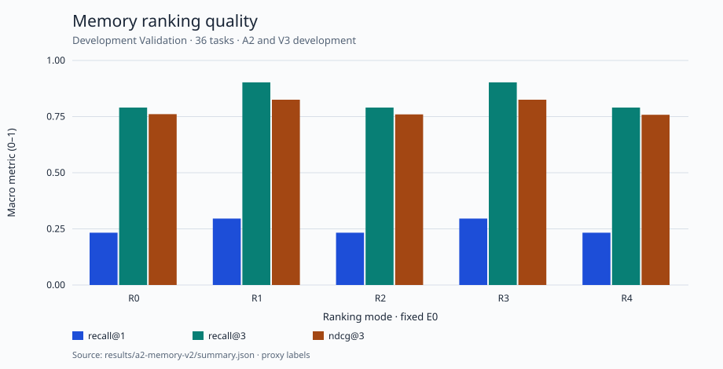
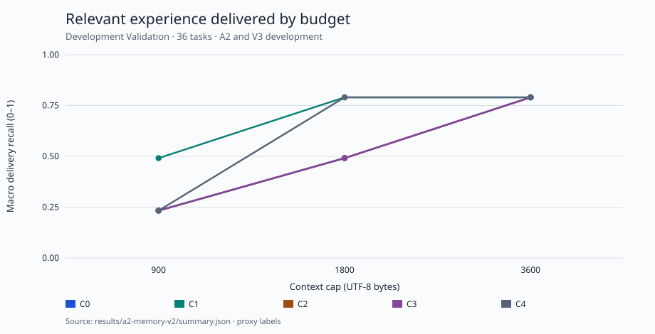
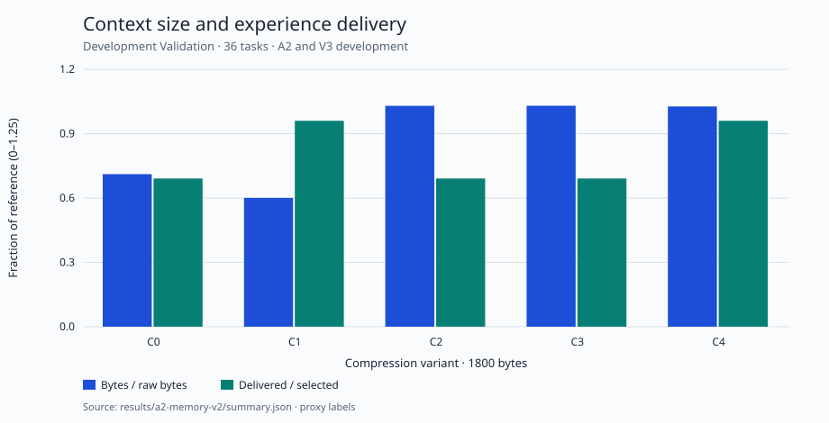
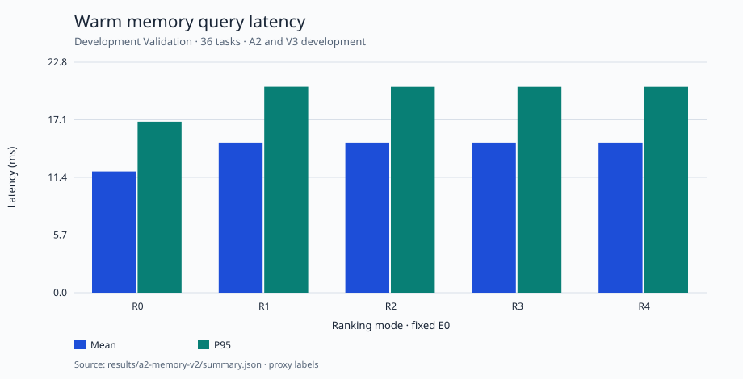
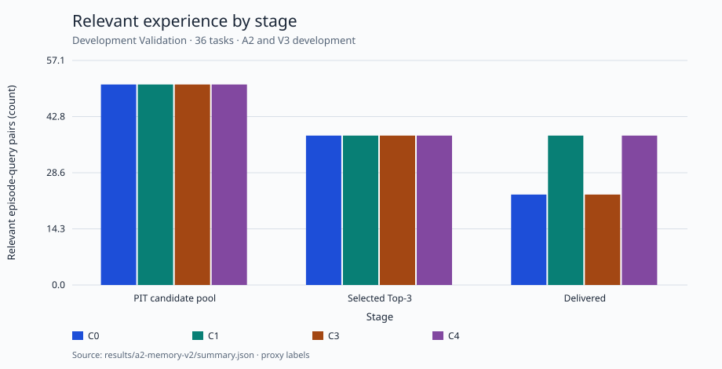

# A2-V2 Episodic Memory Optimization

## 决策

保留历史 M3 对应的 **E0 / R4 / C1，Top-3，1800 bytes，同股票**。冻结前，只有 3 道 Calibration 查询同时拥有超过 3 条合法候选和至少一条相关经验。冻结后 Validation 对应数量为 8。排序结论为 **INSUFFICIENT EVIDENCE**。C4 在 1800 bytes 下恢复了 C2/C3 丢失的经验，并送达了不确定性和决策日期，但花费更多字节，900 bytes 时送达率下降。

## 数据与原实现

基线为远端 main 的 `341c4414cb9e4cccc12dc2909e98183ef8479f94`。原流程在结算可用后写入 Episode，SQLite 保存版本，Qdrant 索引可重建。原查询由 ticker 和 MarketReport 前 600 字符组成。M3 以 0.65 语义、0.25 时间衰减、0.10 证据质量排序，缺省证据质量按引用数量回退。原上下文删除完整结算和决策日期，并对 lesson 和 potential_error 分别截到 220 与 150 字符。

历史 A2 的 20 道题中有 14 道按同股票、同 Action 代理口径具有相关经验。M1、M2、M3 的 Recall@1 分别为 0.268、0.107、0.268，Recall@3 为 0.565、0.631、0.565，送达分别为 34/48、34/48、48/48。M3 将 29,620 bytes 压到 18,534 bytes，减少 37.4%。历史 M2 的 Recall@3 高于 M3。

本轮读取 20 道 A2 Development 归档中的决策、证据、结算和 MarketReport，用现有 MomentumBackend 从合法行情重新生成 80 道 V3 Development 的决策并独立结算。V3 行情仅扫描到 2026-08-07 的开发期结算边界，冻结每个资产的行情前缀指纹。按各 cohort 的决策日期分为 Warm-up 30、Calibration 34、Validation 36；历史 Episode 合计 100。各股票始终按 cohort、实验组、决策、结算和 Reflection 时点隔离。

| Cohort | 阶段 | 任务 | 合法同股票候选 | 1–3 条候选的任务 | 有相关代理经验 |
| --- | --- | ---: | ---: | ---: | ---: | ---: |
| A2 | Calibration | 6 | 24 | 2 | 5 |
| V3 | Calibration | 28 | 40 | 28 | 13 |
| A2 | Validation | 8 | 60 | 0 | 8 |
| V3 | Validation | 28 | 76 | 28 | 21 |

两个评测分区均为 0 个无经验任务，Warm-up 专用于建立历史库。Validation 共有 136 条合法同股票候选，以及 1,763 条按 cohort 和时点合格但被同股票限制排除的跨股票候选。跨股票记录只做可用数量统计。

相关性代理只比较 cutoff 前已知的五日动量方向和波动风险状态。两个均相同为 3，只匹配动量为 2，只匹配风险为 1，均不匹配为 0。Recall 用 grade ≥2，nDCG 使用四档等级，旧同 Action 代理另外记录。Validation 的 Recall 分母为 29 道正例查询、nDCG 分母为 35 道有非零等级的查询。标签与规则反思共享行情特征，可能偏好与标签相似的表示。这里没有独立人工 Gold，也不能由代理 Recall 推出跨股票迁移或决策收益。合成边界用例独立在测试套件中运行。

## 新实现和冻结

- StructuredReflection 在独立 SQLite 表中保存，原 Episode 仍可按旧 schema 读取。原理由、Action、结算、时点和证据引用由确定性代码绑定并校验。规则建议与结算事实分字段保存。历史回放同时记录实际生成时间和模拟可用时间。
- E0 为旧表示，E1 增加原决策理由，E2 使用结构化情境、理由和经验。三种表示各用独立 Qdrant 索引，使用历史 **CPU BGE-small** 量化权重、384 维、CLS/L2、原 query 前缀。两线程、单进程。三种表示分别有 95/100、95/100、100/100 次首次编码，最大输入 43、60、80 代理 tokens，截断 0。首批 64 条写入与建库合计 2.65 s，追加 36 条合计 1.54 s，所有索引与 SQLite 核对无差异。
- R0–R4 因素消融预先冻结。先按 Calibration R1 的 nDCG 选表示，再选排序。E2/R0 在 Calibration 并列最高，R0 只按时间排序，因而 E2 对此组合没有影响。它与历史 R4 同为 0.958，且候选支持未过门槛。冻结配置为 E0/R4。
- 输出 `protocol-freeze.json` 后运行 Calibration，并在索引追加 Validation Episode 和计算其指标前保存 `freeze.json`。Validation 只验证预先定义的组合，未调整权重。结果中的 case、ticker 和 Memory ID 使用哈希，报告没有原始方向历史、收益或证据文本。

## 表示和排序

| Validation 配置 | Recall@1 | Recall@3 | Recall@5 | MRR | nDCG@3 |
| --- | ---: | ---: | ---: | ---: | ---: |
| E0/R4 冻结基线 | .233 | .790 | .822 | .644 | .758 |
| E0/R1 纯语义 | .296 | .902 | .940 | .725 | .825 |
| E1/R1 加决策理由 | .293 | .897 | .957 | .690 | .814 |
| E2/R1 结构化情境 | .371 | .790 | .951 | .766 | .807 |
| E2/R0 Calibration 并列第一 | .233 | .790 | .822 | .649 | .761 |

E0/R1 相对 R4 的 nDCG@3 配对差为 **+0.067**，按 ticker 聚类的 95% Bootstrap 区间为 **[-0.016, +0.126]**，35 个配对中改善 15、下降 7、持平 13。Recall@3 差 **+0.112**，区间 **[0.000, +0.202]**，29 个配对中改善 6、下降 1、持平 22。候选 Oracle Recall 为 1，候选池小，主要损失发生在 Top-3 选择。E2 提高了 Recall@1，却比 E0/R1 少送达不少相关经验。E1 的 Validation nDCG 也低于 E0/R1。现有证据不足以执行双视角 E3 或跨股票 X1/X2，保留 X0。

E0/R4 和 E0/R1 的 Validation 平均/P95 均约 **14.8/20.3 ms**。两者复用同一次向量查询计时，包含 SQLite 读取和筛选、预热后的 Qdrant 查询和各自排序，不含模型冷启动和上下文选择；其中约 11.9 ms 来自实验实现的 SQLite 扫描及结构验证。R0 约 12.0/16.9 ms。本机与其他任务共享，时间只用于本轮同环境比较。

## 上下文压缩

每题固定 E0/R4 的相同 Top-3 IDs 和顺序。C0/C1 按原始接口生成 full/compact context；C2 把历史情境、完整旧 lesson、引用、Action、时间和 uncertainty 划为必须字段，新增结构化 process_lesson 与结算细节作为可选。C3 在可选字段排序中加入主题、关键词和字段优先级。Calibration 有 6/34 道题在 C2 或 C3 下比 C1 少送达整条经验，超过预设 10% 门槛，因此执行 C4，先为多个经验保留必须字段，再分配可选字段。

| Validation 配置 | 预算 bytes | 平均实际 bytes | 送达相关 Recall | 完整旧 lesson / 召回 | 不确定性 / 送达 |
| --- | ---: | ---: | ---: | ---: | ---: |
| C0 | 1800 | 1,231.9 | .491 | 72/100 | 0/72 |
| C1 | 1800 | 1,070.0 | .790 | 100/100 | 0/100 |
| C2 | 1800 | 1,783.0 | .491 | 72/100 | 72/72 |
| C3 | 1800 | 1,783.8 | .491 | 72/100 | 72/72 |
| C4 | 1800 | 1,779.4 | .790 | 100/100 | 100/100 |
| C1 | 900 | 770.6 | .491 | 72/100 | 0/72 |
| C4 | 900 | 882.0 | .233 | 36/100 | 36/36 |
| C4 | 3600 | 2,976.4 | .790 | 100/100 | 100/100 |

Validation 主预算下，候选的 51 个相关经验-查询对被 Top-3 保留 38 个，C1 和 C4 均送达 38 个，C3 只送达 23 个。C4 比 C1 平均多用 709.4 bytes，BGE tokenizer 代理均值从 411.3 增至 632.7；选择平均耗时约从 0.16 ms 增至 0.52 ms。C4 的新增规则 lesson 主预算只装入 16/100，和比较各组使用的完整原始 lesson 是两个指标。Lesson 保留以字符串完全一致计数，未做人工语义判定。历史引用、Action、可用日期和已传送数值在主预算的 C1/C4 都通过完整性校验。C1 按既有设计省略历史决策日期、完整结果和显式不确定性；C4 保留决策日期和不确定性，完整结算细节是可选字段。整个实验预算违规与 PIT 违规均为 **0**。没有把 bytes 或本地代理 tokens 换算为真实模型消耗。

## 尚未执行的实验

本轮真实 GLM 请求和 Token 均为 **0**。已实现带显式启用、A2 账本、结构化输出、一次格式修复以及持久化缓存的 Reflection adapter，测试使用 mock。真实 Reflection 与 Trader 配对实验的预算和停止条件见 [未来协议](LLM-PROTOCOL.md)。当前样本和标签不足以支持直接启动付费对比；如果先补充独立标注和足量候选，可用小规模 Reflection pilot 检查生成经验的事实保真及可迁移性。离线 MomentumBackend 不使用历史经验调整决策。

## 复现与图表

[命令](COMMANDS.md) · [测试](TESTS.md) · [数据审计](data-audit.json) · [表示](representation-ablation.json) · [排序](ranking-ablation.json) · [压缩](compression-ablation.json) · [送达审计](memory-delivery-audit.json)

