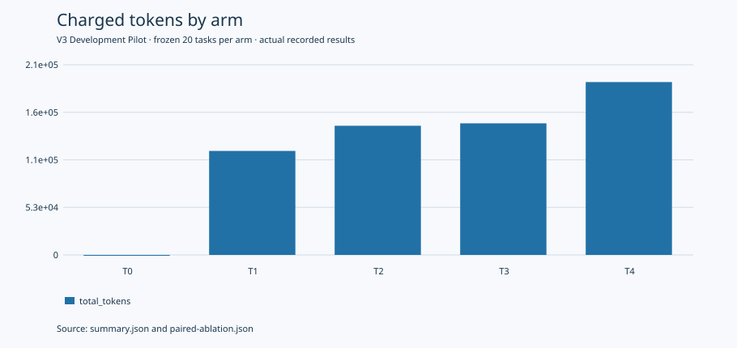
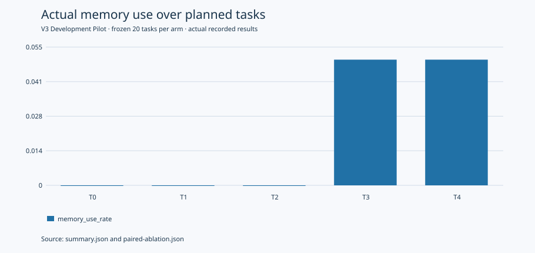
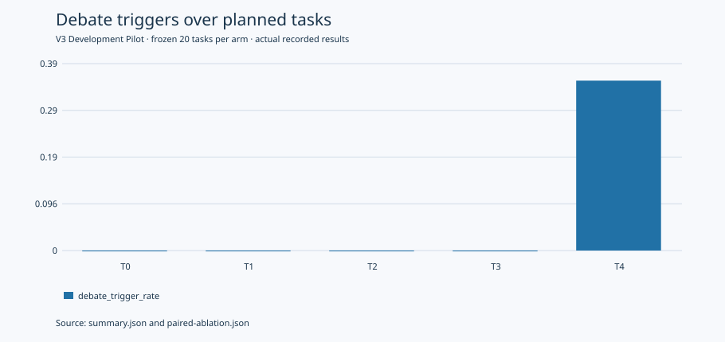

# Phase 3.0–3.1 Final Agent Pilot

集成配置 **S3 / C1-segments**。完成预测归档 4/100 个实例，真实模型实例 4/80。

真实 BigModel HTTP **22** 次。账本实际计费/保守记账 **49,219** Tokens，其中有可用供应商用量 **49,219**。B2 余 **950,781**，项目余 **14,332,442**。

**正式 Pilot 未全部完成，结算仍封存。** 因此没有配对 Alpha 或正式配置选择。

修正后的四个真实 Smoke 实例均成功，实际 RAG、Memory 和 Debate 路径通过。**预算检查失败，正式 20 题 Pilot 未启动。**

- 修正后 Smoke 14 次请求、32,308 Tokens。首次技术 Smoke 8 次请求、16,911 Tokens。两轮都计入同一 Pilot 子额度，全部 22 个提供方响应的模型身份已核验且用量可对账。
- 修正后的 T1、T2、T3、T4 分别消耗 4,735 / 7,093 / 7,146 / 13,334 Tokens。按冻结观测速率，剩余 76 个实例预计需要 613,852 Tokens，加一笔最大请求预留后为 623,985。Pilot 可用 450,781，差 173,204。原协议双倍压力估计为 1,227,704。
- 若以同一 Smoke 速率外推，完成剩余 Pilot 后 B2 只余 336,929 Tokens。之后若保留 T1 与增强组做剩余 60 题，估计需 709,680–1,084,140 Tokens。该估算来自一题，不能作为真实用量保证。
- 未产出方向命中率、Mean Alpha、配对 Alpha 和质量成本 Pareto 图。五张现有图只反映最新一轮已观测的 Smoke 记录，完成率与曝光率按 20 道计划分母展示。
- 首轮技术问题是 Flash 提示允许四个工具但运行器只允许两个。修复后同样的公开任务重新通过离线与真实 Smoke。首轮没有结算或进入正式结果。

## 各组结果

| 组 | 完成/20 | 非 HOLD | 条件方向命中 | Mean / Median Alpha | 引用合法 | Tokens | Mean / P95 s |
| --- | ---: | ---: | ---: | ---: | ---: | ---: | ---: |
| T0 | 0/20 | 0% | 不可用 (0) | 不可用 / 不可用 | 0/0 | 0 | 不可用 / 不可用 |
| T1 | 1/20 | 5% | 不可用 (0) | 不可用 / 不可用 | 1/1 | 4,735 | 7.16 / 7.16 |
| T2 | 1/20 | 5% | 不可用 (0) | 不可用 / 不可用 | 1/1 | 7,093 | 15.36 / 15.36 |
| T3 | 1/20 | 0% | 不可用 (0) | 不可用 / 不可用 | 1/1 | 7,146 | 13.21 / 13.21 |
| T4 | 1/20 | 0% | 不可用 (0) | 不可用 / 不可用 | 1/1 | 13,334 | 25.47 / 25.47 |

Alpha 使用方向调整后的股票相对 SPY 五日价格收益。任务失败保留在分母，条件方向准确率只统计已结算的非 HOLD。这里没有模拟交易成本、可执行组合或实际投资收益。引用合法性仅检验当前范围和可用性。

未完成配对，不能判断 RAG、Memory 或 Debate 是否改善决策，也不能从本轮 Smoke 选择 Development 配置。

## Memory 与 Debate

T3、T4 实际注入经验的任务分别为 1/1 与 1/1。两组注入共 2 条。候选稀缺、空记忆与模型实际曝光分开计数。Warm-up 来自规则策略和成熟的独立历史结算。

T4 触发 1 次，两角色成功 1 次，动作冲突 1 次。角色和裁决共增加 5,558 Tokens、12.37 秒。跨组动作差属于整个分支的观察对比。

该 Pilot 的小样本和可能的模型预训练污染限制推断。预测隔离只约束可见输入与本地工具，不能证明模型没有见过公开金融事件。Holdout 继续封存。

[冻结配置](freeze.json) · [协议修订](protocol-amendment.md) · [预算](budget-summary.json) · [测试](TESTS.md) · [复现](COMMANDS.md)

