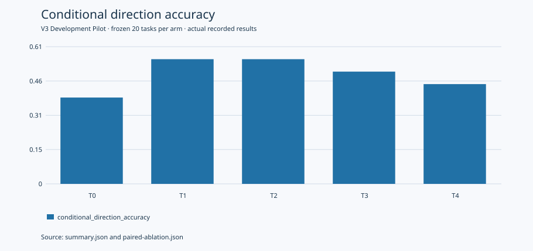
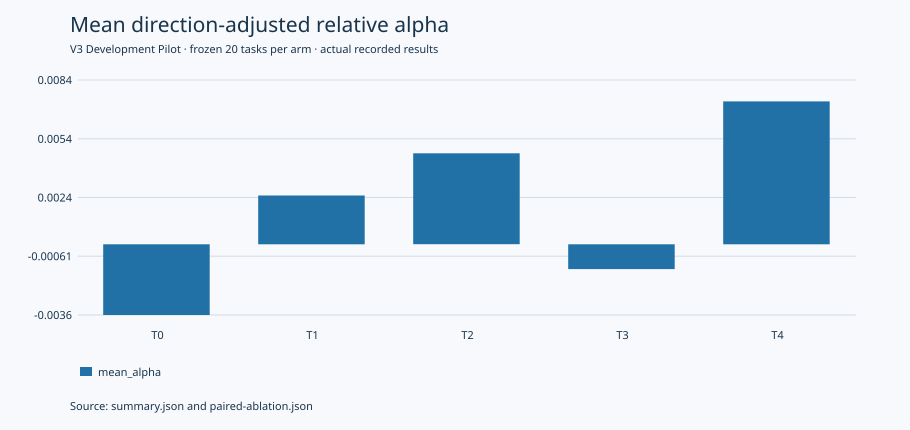
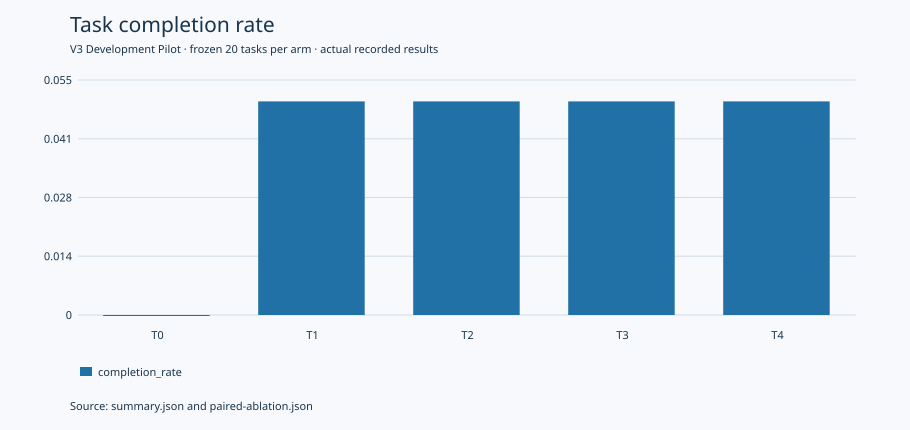
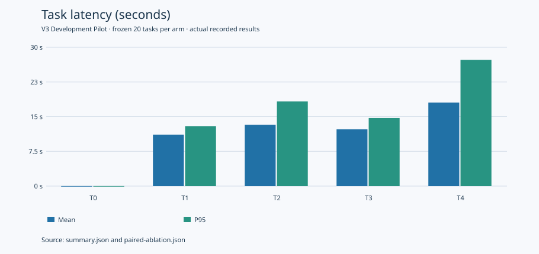
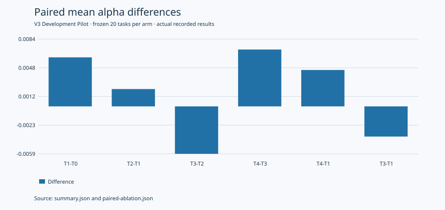
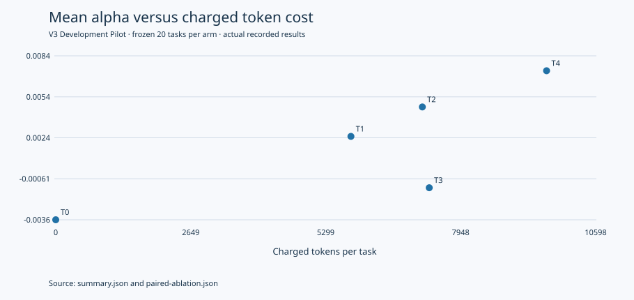

# Phase 3.0–3.1 Final Agent Pilot

集成配置 **S3 / C1-segments**。完成预测归档 100/100 个实例，真实模型实例 80/80。

真实 BigModel HTTP **260** 次。账本实际计费/保守记账 **616,009** Tokens，其中有可用供应商用量 **616,009**。B2 余 **1,883,991**，项目余 **13,765,652**。

按预注册准入，推荐进入后续 Development 的配置为 **T2**；本轮只完成配置选择，没有启动剩余 60 题。T2 对 T1 的配对 Mean Alpha 差为 +0.00215，但时间块 Bootstrap 95% 区间 [-0.00747, +0.01050] 包含零，Pilot 结论仍属探索性。

## 额度迁移与执行审计

- 迁移前项目总上限 15,000,000，迁移后保持不变；B2 从 1,000,000 调至 2,500,000，Reserve 从 3,000,000 调至 1,500,000，Pilot 子额度从 500,000 调至 900,000，B3 保持 4,000,000。迁移前 Reserve 已保守记账 8,384，转出 1,500,000 后尚余 1,491,616。当前调整记录、UTC 时间及配置指纹见 [预算迁移审计](budget-reallocation-2026-11-29.json)。SQLite 的预算迁移表新增一条事件；原 871 条请求记录未改写或删除。
- 原 freeze.json 保持不变，SHA256 0ae6744862a09eae9b5a45acaeaa9e58dc425af03492fb974c8b7340960412db. 四个修正后 Smoke 按原 freeze、输入指纹、模型身份和账本回执核验后直接复用，共 14 次请求、32,308 Tokens。首轮技术 Smoke 共 16,911 Tokens（T1–T3 失败，T4 成功）；全部计入总账，四条旧 freeze 检查点均未并入正式预测。
- 本次总计 260 次官方 BigModel 请求、616,009 个供应商确认 Tokens（输入 585,693，输出 30,316；推理细项 4,038，缓存 0），没有重试或预算拒绝。Pilot 子额度余 283,991；B2 余 1,883,991；项目余 13,765,652。
- PIT 审计：T0–T4 的 future-evidence violation 均为 0。引用任务验证为 T0–T3 各 20/20、T4 18/18。详见执行审计与汇总。
- 正式预测 100/100（T0–T4 各 20），其中成功 98、失败 2。两项失败均为 T4 Bear 角色 invalid_role_output，已计入分母与 Token 用量；无系统级停止。逐题脱敏结果、执行审计及结算封存见 [predictions.jsonl](predictions.jsonl)、[execution-audit.json](execution-audit.json) 与 [prediction-seal.json](prediction-seal.json)。

## 各组结果

| 组 | 完成/20 | 非 HOLD | 条件方向命中 | Mean / Median Alpha | 引用合法 | Tokens | Mean / P95 s |
| --- | ---: | ---: | ---: | ---: | ---: | ---: | ---: |
| T0 | 20/20 | 65% | 0.385 (13) | -0.00362 / 0.00000 | 20/20 | 0 | 0.01 / 0.01 |
| T1 | 20/20 | 45% | 0.556 (9) | 0.00250 / 0.00000 | 20/20 | 115,866 | 11.14 / 12.97 |
| T2 | 20/20 | 45% | 0.556 (9) | 0.00465 / 0.00000 | 20/20 | 143,915 | 13.26 / 18.34 |
| T3 | 20/20 | 30% | 0.500 (6) | -0.00127 / -0.00000 | 20/20 | 146,629 | 12.28 / 14.72 |
| T4 | 18/20 | 45% | 0.444 (9) | 0.00731 / 0.00000 | 18/18 | 192,688 | 18.09 / 27.32 |

Alpha 使用方向调整后的股票相对 SPY 五日价格收益。任务失败保留在分母，条件方向准确率只统计已结算的非 HOLD。这里没有模拟交易成本、可执行组合或实际投资收益。引用合法性仅检验当前范围和可用性。

## 配对与准入

- T1-T0 配对 20/20，Mean Alpha 差 0.00611，95% 区间 [-0.00130, +0.01700]（12 个时间块）。
- T2-T1 配对 20/20，Mean Alpha 差 0.00215，95% 区间 [-0.00747, +0.01050]（12 个时间块）。
- T3-T2 配对 20/20，Mean Alpha 差 -0.00592，95% 区间 [-0.01395, +0.00137]（12 个时间块）。
- T4-T3 配对 18/20，Mean Alpha 差 0.00709，95% 区间 [-0.00150, +0.01914]（12 个时间块）。
- T4-T1 配对 18/20，Mean Alpha 差 0.00453，95% 区间 [-0.00198, +0.01601]（12 个时间块）。
- T3-T1 配对 20/20，Mean Alpha 差 -0.00376，95% 区间 [-0.01021, +0.00102]（12 个时间块）。

- T2 通过全部准入条件。
- T3 未通过 alpha。
- T4 未通过 p95。

后续 60 题按实测均值估算 **779,343** Tokens，当前 B2 账面按该估算足够。双倍压力估算 1,558,686 Tokens。

## 检索与传输边界

本轮 S3 使用冻结的固定检索 Query “Recent financial results, risks and company outlook”，Tool 走本地 transport。结果不构成自主多轮检索验证，也不构成真实 MCP 端到端验证。未来 60 题按本轮实际均值估算为 779,343 Tokens，双倍估算为 1,558,686；该数字不是成本保证。B2 阶段余额可覆盖该均值估算，但剩余 60 题未启动，需独立执行授权。

## Memory 与 Debate

T3、T4 实际注入经验的任务分别为 13/20 与 11/20。两组注入共 51 条。候选稀缺、空记忆与模型实际曝光分开计数。Warm-up 来自规则策略和成熟的独立历史结算。

T4 触发 7 次，两角色成功 5 次，动作冲突 4 次。角色和裁决共增加 40,857 Tokens、91.61 秒。跨组动作差属于整个分支的观察对比。

该 Pilot 的小样本和可能的模型预训练污染限制推断。预测隔离只约束可见输入与本地工具，不能证明模型没有见过公开金融事件。Holdout 继续封存。

[冻结配置](freeze.json) · [协议修订](protocol-amendment.md) · [预算](budget-summary.json) · [测试](TESTS.md) · [复现](COMMANDS.md)

